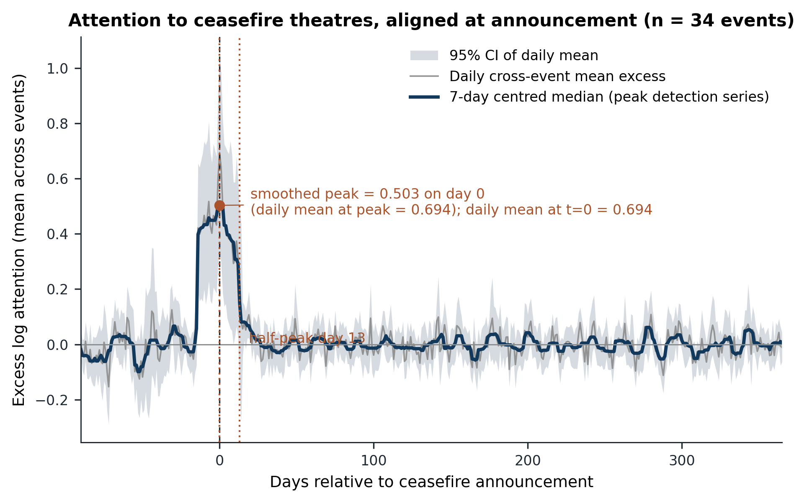
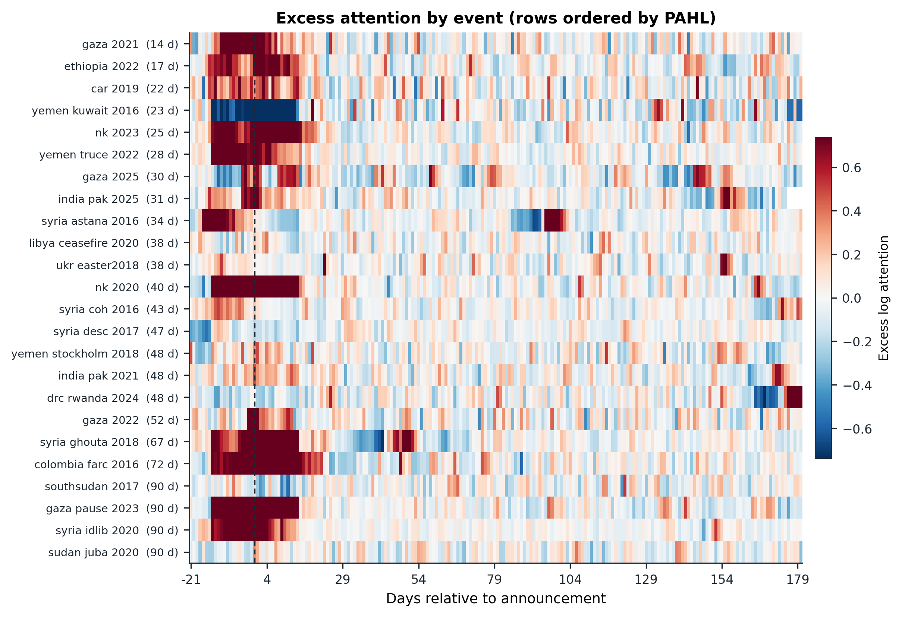
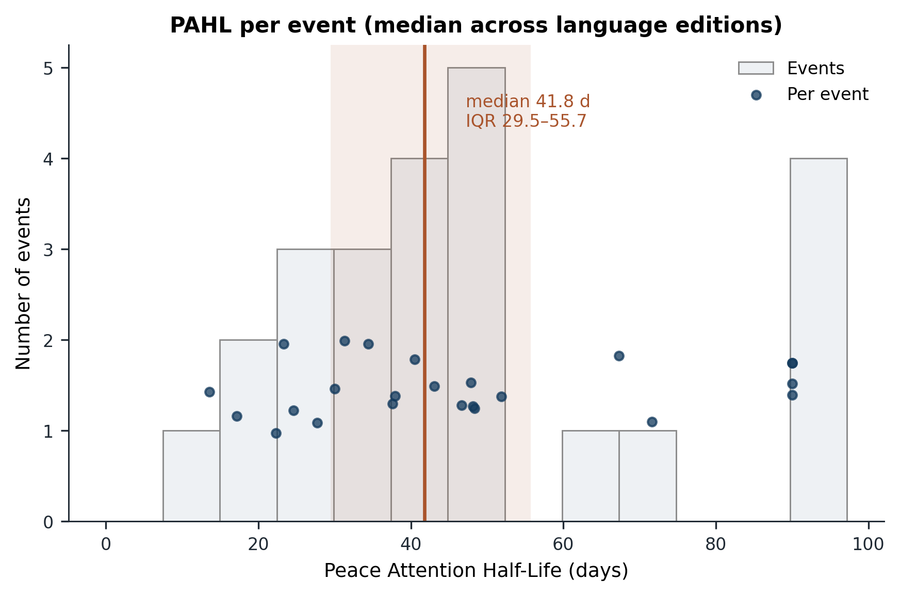
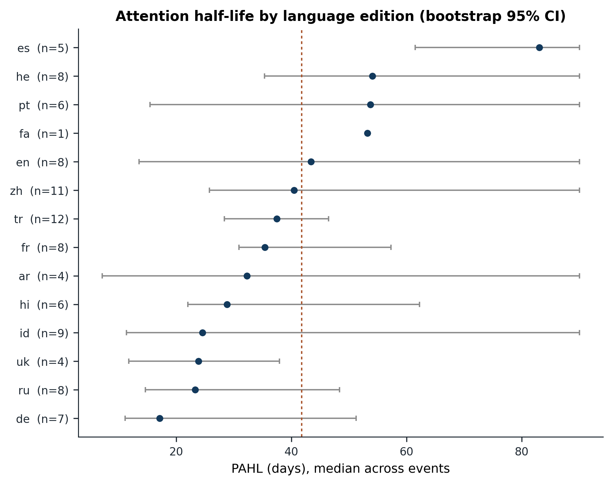
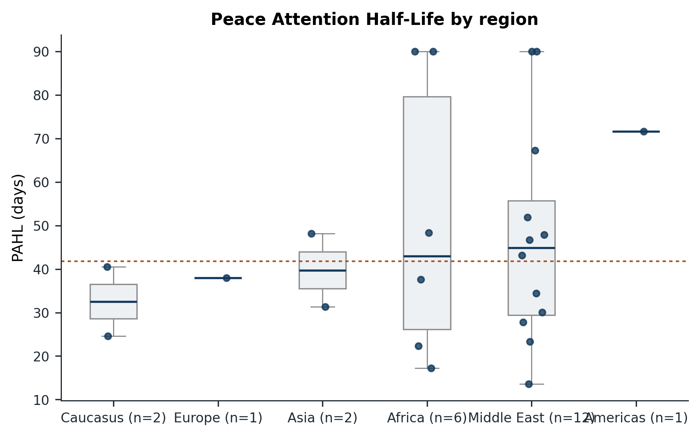
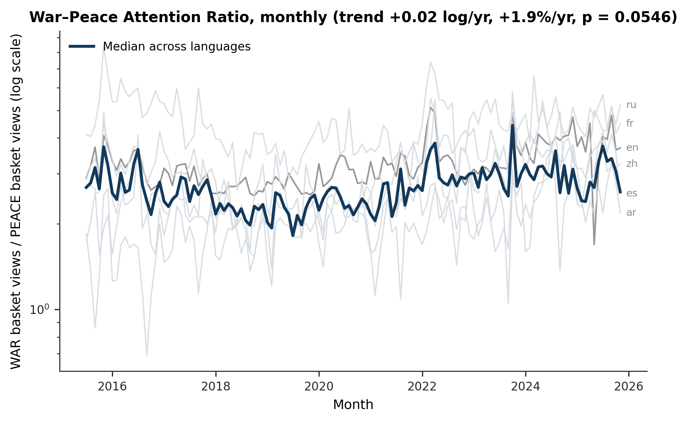
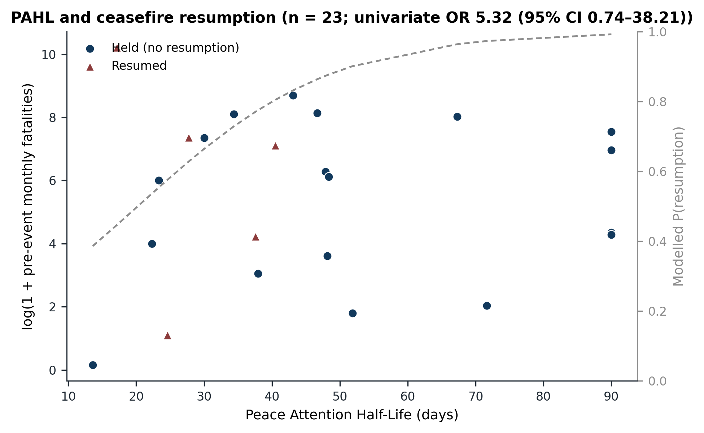
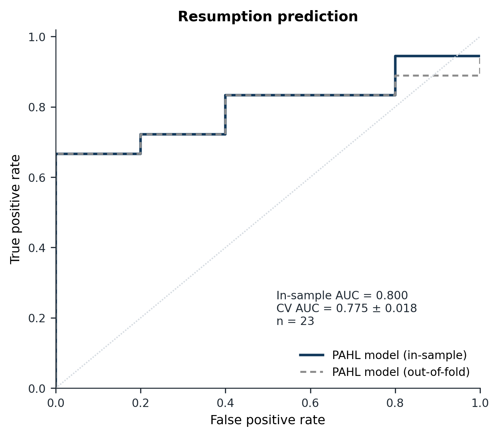
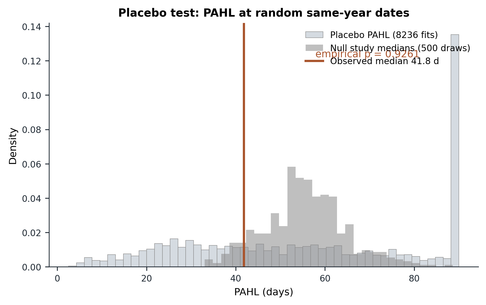
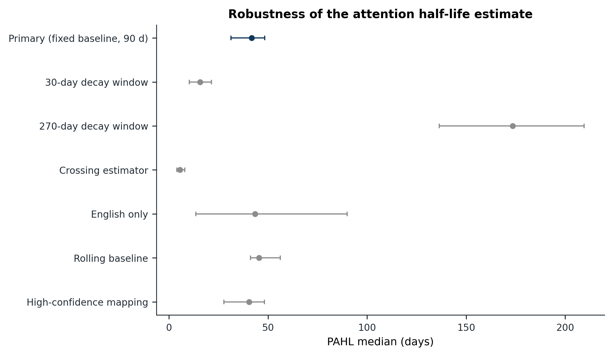

# The Half-Life of Peace — Statistical Analysis Report

This report is generated by `analysis/run.py` from the frozen input tables in `data/` and is the numeric source for the manuscript. Every estimate below is produced by the code in `analysis/` and `src/`; no number is typed by hand. Analysis version 1.0.0. Inputs: 36 events, 14 languages, 50 canonical articles, coverage 2015-07-01 to 2025-11-01.

**Design in one paragraph.** Daily Wikipedia pageviews are the measure of attention. For every ceasefire, the conflict-specific article's attention is measured in each language edition; excess attention is log views minus a baseline; the post-announcement peak is located and an exponential decay is fitted to the days after the peak, giving the Peace Attention Half-Life (PAHL, days). A multilingual focus is mandatory for interpretation: each event's PAHL is the median across language editions with a valid fit, and the number of editions is reported for every event.

## 1. Headline findings

- **PAHL.** Median 41.8 days (IQR 29.5 to 55.7; cluster-bootstrap 95% CI 31.3 to 48.4); estimated for 24/36 events. The placebo test **fails**: the observed median PAHL (41.80) is not distinguishable from — indeed is shorter than — the median under random same-year dates (55.29), with one-sided empirical p = 0.926 and two-sided p = 0.156 (8236 placebo fits across 24 events). The measure as implemented therefore does not isolate a ceasefire-specific decay.
- **War versus peace baskets.** Median PAHL is 65.3 days for the WAR basket (n = 33) and 81.6 days for the PEACE basket (n = 30); the paired median difference (WAR − PEACE), computed within events, is 0.0 days (bootstrap 95% CI -14.7 to 6.2; n = 30 events with both). The level contrast points to *peace_decays_slower (WAR basket median PAHL < PEACE basket median PAHL)*, but the paired contrast is centred on zero.
- **Resumption prediction (exploratory, underpowered).** With n = 23 events (18 resumed, 5 not), a one-standard-deviation longer PAHL is associated with 5.32 times the odds of resumption (95% CI 0.74 to 38.21; p = 0.096); in-sample AUC = 0.800, repeated cross-validated AUC = 0.775 (SD 0.018 across repeats), leave-one-out predictive AUC = 0.667. This is an exploratory association on a small sample and is not a validated classifier; no causal claim is made.
- **Event study.** The daily cross-event mean excess attention is 0.694 at day 0; the 7-day median used to locate the peak peaks at 0.503 (day 0), and falls to half that peak by day 13 (n = 34 events). These are two different statistics: the former is the unsmoothed daily mean, the latter is the smoothed series used for peak detection.
- **Attention spike (claim A).** Observed median peak excess = 0.504 (mean 0.811; n = 27 events), versus a random-date placebo median of 0.228 and 95th percentile 1.490; one-sided empirical p = 0.006 comparing cross-event medians (13433 placebo dates). The spike placebo **passes** (before multiplicity adjustment; see §7.1b). This is a *different* test from the decay placebo below: it asks whether attention rises on ceasefire dates, not whether its decay rate is event-specific.
- **WPAR.** Monthly War–Peace Attention Ratio trend 0.0186 per year (95% CI -0.0004 to 0.0375; p = 0.055), i.e. about +1.9% per year in ratio terms. Highest median ratio: ru (4.42); lowest: he (1.64).

## 2. Data and sample

| input | rows | file | sha256 (first 12) |
| --- | --- | --- | --- |
| pageviews | 1736563 | data/processed/pageviews.csv | a7a8902b6389 |
| articles | 50 | data/processed/articles.csv | 7f13b47f58c6 |
| langlinks | 700 | data/processed/article_langlinks.csv | 752e8d57c1ab |
| ucdp_country | 5782 | data/processed/ucdp_monthly_country.csv | 09e0576f63ee |
| ucdp_dyad | 20443 | data/processed/ucdp_monthly_dyad.csv | 386f0a31927c |
| ucdp_mapping | 102 | data/processed/ucdp_country_mapping.csv | 85c9f66a1e2a |
| events | 36 | data/events/ceasefires.csv | 5f417105a24e |

The attention panel contains 644 article–language series (630 observed, 14 present in the interlanguage-link table but with no pageview rows) across 14 languages and 3777 days, giving 1685694 positive daily observations; 643612 panel cells are missing because the article did not yet exist. Existence is handled temporally: pageview rows begin when an article is created or renamed, so days before an article's first pageview are treated as missing rather than as zero attention (307 series have partial coverage).

Of 36 ceasefire events, 34 were mapped to a conflict article covering the theatre (the mapping is heuristic and auditable; methods and scores are in `analysis/tables/table1_events.csv`), and 24 produced a usable PAHL. Unmapped events (israel_iran_2025, thai_camb_2025): for these the article universe contains no dedicated conflict article, so they remain in the event table but cannot contribute attention measures.

**Events without a PAHL estimate** (reason, number of valid language editions):

| event | reason | language fits | article |
| --- | --- | --- | --- |
| minsk2_2015 | too_few_language_fits | 0 | War in Donbas |
| mali_2015 | too_few_language_fits | 0 | Mali War |
| southsudan_2015 | too_few_language_fits | 0 | South Sudanese Civil War |
| ukr_sept2015 | too_few_language_fits | 0 | War in Donbas |
| myanmar_nca_2015 | too_few_language_fits | 0 | Myanmar civil war (2021–present) |
| philippines_2016 | too_few_language_fits | 0 | Philippine drug war |
| doha_2020 | too_few_language_fits | 0 | War in Afghanistan (2001–2021) |
| afghanistan_2020 | too_few_language_fits | 0 | War in Afghanistan (2001–2021) |
| sudan_jeddah_2023 | too_few_language_fits | 0 | Sudanese civil war (2023–present) |
| israel_lebanon_2024 | too_few_language_fits | 0 | Hezbollah–Israel conflict (2023–present) |
| israel_iran_2025 | unmapped | 0 | — |
| thai_camb_2025 | unmapped | 0 | — |

Failure reasons among excluded events: too_few_language_fits = 10, unmapped = 2. The dominant mechanism is that the conflict article did not exist before the event (articles created during a war cannot provide a pre-event baseline) or that the announcement produced no measurable attention spike. These are substantively informative rather than missing-at-random: the panel under-represents sudden new wars relative to long-running conflicts.

**Resumption coding.** Monthly UCDP GED (v26.1) fatalities are joined through the curator's theatre mapping (including the documented proxy PSE → Israel); an event resumes if, within the 12 months beginning with the event month, monthly fatalities exceed 25% of the mean of the preceding 6 months for at least 2 consecutive months. 33 events can be coded; 25 resumed (base rate 75.8%); 3 cannot be coded because the 12-month follow-up is not yet available (status counts: ok=33, insufficient_followup=3). Events with a zero pre-event fatality mean would have a degenerate relative threshold (any fatality counts); 0 such events are present and flagged in `analysis/tables/table6_resumption_coding.csv`.

## 3. Event study

Aligning all mapped events at the announcement date, the **daily** cross-event mean excess attention is 0.694 at day 0. The **7-day centred median** of that curve — the series used to locate the peak — peaks at 0.503 on day 0 and reaches half that peak at day 13 (Figure 1; the figure plots both series and annotates both values, so the text and the figure cannot drift apart). Using the fixed pre-event baseline instead gives a peak at day 0 and half-peak at day 14. The WAR basket peaks on day 0 (smoothed excess 0.063) and the PEACE basket on day 0 (smoothed excess 0.080) — the aggregate response is dominated by the announcement-day spike and decays rapidly relative to PAHL defined at the article level.

*Figure provenance: results.event_study.response_by_day; peak_day; half_max_day; peak_mean_excess; peak_mean_excess_daily; day0_mean_excess; n_events.*

*Figure provenance: event-level excess curves from analysis artifacts (not serialised); row order and labels from results.pahl.per_event.*

## 4. The Peace Attention Half-Life

**Estimator.** For each event–language series, the log attention is smoothed with a centred 7-day median; the peak is searched in the 14 days after the announcement; on the days between the peak and 90 days after it (with excess above 5% of the peak) we fit log E_t = log A − λ·t by the Theil–Sen estimator, a robust median of pairwise slopes. PAHL = ln 2 / λ. Fits with λ ≤ 0 are invalid; fits whose half-life exceeds the 90-day window are right-censored at 90 days and flagged (censored fraction 0.233). The event-level estimate is the median across language editions with a valid fit, and the minimum is one edition; the multilingual-only sensitivity uses at least two.

**Distribution.** Median PAHL = 41.8 days, IQR 29.5 to 55.7, mean 46.9 (SD 24.1), range 13.6 to 90.0; n = 24/36 events; cluster-bootstrap 95% CI for the median 31.3 to 48.4 (2000 resamples). The distribution is in Figure 2 and the per-event estimates in Table 1 below.

Fit quality: the median R² of the log-linear decay fits across events is 0.288. The fits are noisy at the individual-language level (daily pageview noise, weekly cycles and censoring), which is why the event-level estimate is a cross-language median and why the half-life is reported with an IQR rather than as a precise per-event constant.

*Figure provenance: results.pahl.per_event (pahl_days); results.pahl.median, iqr_low, iqr_high.*

*Figure provenance: results.pahl.by_language (median, bootstrap_ci_low, bootstrap_ci_high, n_fitted).*

*Figure provenance: results.pahl.per_event (region, pahl_days); results.pahl.median.*

**Table 1. Event-level PAHL** (absolute values in days; `n_languages` = language editions entering the median; `censored` = proportion of those editions whose half-life was not resolved within 90 days).

| event | region | n_languages | PAHL (d) | peak excess (log) | censored fraction |
| --- | --- | --- | --- | --- | --- |
| syria_coh_2016 | Middle East | 6 | 43.1 | 0.28 | 0.17 |
| yemen_kuwait_2016 | Middle East | 1 | 23.3 | 0.16 | 0.00 |
| colombia_farc_2016 | Americas | 5 | 71.6 | 2.70 | 0.40 |
| syria_astana_2016 | Middle East | 2 | 34.4 | 0.68 | 0.00 |
| syria_desc_2017 | Middle East | 6 | 46.7 | 0.27 | 0.17 |
| southsudan_2017 | Africa | 1 | 90.0 | 0.41 | 1.00 |
| syria_ghouta_2018 | Middle East | 9 | 67.3 | 0.79 | 0.44 |
| ukr_easter2018 | Europe | 1 | 37.9 | 0.14 | 0.00 |
| yemen_stockholm_2018 | Middle East | 2 | 47.9 | 0.54 | 0.50 |
| car_2019 | Africa | 2 | 22.3 | 1.38 | 0.00 |
| syria_idlib_2020 | Middle East | 5 | 90.0 | 0.95 | 0.60 |
| sudan_juba_2020 | Africa | 3 | 90.0 | 0.26 | 0.67 |
| libya_ceasefire_2020 | Africa | 1 | 37.6 | 0.93 | 0.00 |
| nk_2020 | Caucasus | 7 | 40.5 | 3.43 | 0.14 |
| india_pak_2021 | Asia | 4 | 48.1 | 1.07 | 0.25 |
| gaza_2021 | Middle East | 3 | 13.6 | 2.18 | 0.00 |
| yemen_truce_2022 | Middle East | 6 | 27.7 | 1.19 | 0.00 |
| gaza_2022 | Middle East | 1 | 51.8 | 1.23 | 0.00 |
| ethiopia_2022 | Africa | 6 | 17.2 | 1.34 | 0.00 |
| nk_2023 | Caucasus | 11 | 24.6 | 2.98 | 0.00 |
| gaza_pause_2023 | Middle East | 3 | 90.0 | 2.21 | 1.00 |
| drc_rwanda_2024 | Africa | 1 | 48.4 | 0.18 | 0.00 |
| gaza_2025 | Middle East | 4 | 30.0 | 1.12 | 0.25 |
| india_pak_2025 | Asia | 7 | 31.3 | 1.10 | 0.00 |

**War versus peace baskets.** Using the same estimator on the two concept baskets (summed raw monthly-article views within each language, log-transformed), the WAR basket median is 65.3 days (IQR 42.8 to 79.8, n = 33) and the PEACE basket median 81.6 days (IQR 40.2 to 90.0, n = 30). For the 30 events where both baskets yield a fit, the paired median difference (WAR − PEACE) is 0.0 days (bootstrap 95% CI -14.7 to 6.2); the mean paired difference is -1.0 days. The direction implied by the basket medians is: peace_decays_slower (WAR basket median PAHL < PEACE basket median PAHL).

**Spike versus decay rate.** Across the 24 events where both statistics exist, the Spearman correlation between the peak excess (spike) and PAHL is -0.037 (95% CI -0.432 to 0.392; p = 0.864; n = 24). A negative correlation means larger announcement spikes have shorter half-lives (regression to the mean); the sign and size of this association is reported here because it bears directly on how the failed decay placebo should be interpreted. Here the correlation is (see §7.1b) (p = -0.037; n = 0.864), so there is 24 evidence that larger announcement spikes decay faster: the regression-to-the-mean explanation for the null decay placebo is no by these data.

**Mapping sensitivity.** Restricting to events mapped by exact or high-confidence fuzzy name (i.e. dropping country-only and multi-candidate fallbacks), the PAHL median is 40.5 days (IQR 26.2 to 50.0, n = 19); the primary median based on all 24 fitted events is 41.8 days. The inference does not depend on the low-confidence mappings.

## 5. War–Peace Attention Ratio

Monthly WPAR (raw WAR-basket views divided by PEACE-basket views) is computed for each of 14 language editions over 125 months. Across languages the global median ratio is 2.65, and the median monthly cross-language IQR of log WPAR is 0.404 (a dispersion, not a ratio). The Newey–West (HAC, 12 lags) trend in log WPAR is 0.0186 log units per year (95% CI -0.0004 to 0.0375; p = 0.055; roughly +1.9% per year). Seasonality, measured as the range of month-of-year effects, is 0.120 log units. The highest median ratio is in ru (4.42) and the lowest in he (1.64). Per-language trends are in `analysis/tables/table4_wpar_by_language.csv` and Figure 4.

*Figure provenance: results.wpar.global_monthly and results.wpar.by_language (monthly WPAR series; trend fields from results.wpar).*

## 6. Does PAHL predict resumption? (exploratory)

The prediction sample is n = 23 events (18 resumed, 5 did not; base rate 78.3%). The primary univariate model is `resumption ~ z(PAHL)`; the adjusted model adds `log1p(pre-event monthly fatalities)`, agreement-type and region fixed effects (ridge-penalised because of the small n). **These models are exploratory and underpowered**: with 18 positives and 5 negatives, a single event moves the estimates substantially and the confidence intervals are wide by construction.

Univariate PAHL: OR = 5.32, 95% CI 0.74 to 38.21, p = 0.096; in-sample AUC = 0.800, repeated stratified 5-fold cross-validated AUC = 0.775 (SD 0.018 across 200 repeats). Leave-one-out predictive AUC = 0.667; the distribution of refitted AUCs on the remaining events spans 0.764 to 0.847 (median 0.788). Spearman correlation between PAHL and resumption = 0.430 (bootstrap 95% CI 0.115 to 0.690; n = 23).

Adjusted model: PAHL OR = 2.03, 95% CI 0.78 to 5.30, p = 0.150; in-sample AUC = 0.967, cross-validated AUC = 0.792 (SD 0.054) with n = 23 and 12 parameters (penalty 2.0). Coefficients are ridge-shrunk and their Wald intervals are approximate; they are reported for completeness, not as a confirmed model.

**Table 2. Logistic coefficients** (log-odds, OR and 95% CI; n is reported on every row).

| model | term | coef | SE | OR | OR CI low | OR CI high | p | n | method |
| --- | --- | --- | --- | --- | --- | --- | --- | --- | --- |
| univariate | const | 1.910 | 0.840 | — | — | — | 0.023 | 23 | statsmodels-mle |
| univariate | pahl_days | 1.672 | 1.006 | 5.32 | 0.74 | 38.21 | 0.096 | 23 | statsmodels-mle |
| adjusted | const | 1.190 | 0.660 | — | — | — | 0.071 | 23 | ridge-irls |
| adjusted | pahl_days | 0.706 | 0.490 | 2.03 | 0.78 | 5.30 | 0.150 | 23 | ridge-irls |
| adjusted | log_pre_fatalities | -0.245 | 0.419 | 0.78 | 0.34 | 1.78 | 0.558 | 23 | ridge-irls |
| adjusted | agreement_type_de-escalation | 0.183 | 0.665 | 1.20 | 0.33 | 4.42 | 0.783 | 23 | ridge-irls |
| adjusted | agreement_type_humanitarian_pause | 0.076 | 0.687 | 1.08 | 0.28 | 4.15 | 0.911 | 23 | ridge-irls |
| adjusted | agreement_type_peace_agreement | 0.023 | 0.637 | 1.02 | 0.29 | 3.57 | 0.971 | 23 | ridge-irls |
| adjusted | agreement_type_truce | -0.331 | 0.674 | 0.72 | 0.19 | 2.69 | 0.623 | 23 | ridge-irls |
| adjusted | region_Americas | 0.046 | 0.694 | 1.05 | 0.27 | 4.08 | 0.947 | 23 | ridge-irls |
| adjusted | region_Asia | 0.093 | 0.684 | 1.10 | 0.29 | 4.19 | 0.892 | 23 | ridge-irls |
| adjusted | region_Caucasus | -0.575 | 0.648 | 0.56 | 0.16 | 2.00 | 0.375 | 23 | ridge-irls |
| adjusted | region_Europe | 0.112 | 0.681 | 1.12 | 0.29 | 4.25 | 0.870 | 23 | ridge-irls |
| adjusted | region_Middle East | 0.574 | 0.601 | 1.78 | 0.55 | 5.76 | 0.339 | 23 | ridge-irls |
| spike_univariate | const | 1.568 | 0.623 | — | — | — | 0.012 | 23 | statsmodels-mle |
| spike_univariate | peak_excess_mean | -1.146 | 0.591 | 0.32 | 0.10 | 1.01 | 0.052 | 23 | statsmodels-mle |

**Peak-excess (spike) model.** Replacing PAHL with the standardised peak excess gives OR = 0.32 (95% CI 0.10 to 1.01; p = 0.052; n = 23; 18 positives, 5 negatives; base rate 78.3%); in-sample AUC = 0.767 and cross-validated AUC = 0.695 (SD 0.016). This tests whether the *size of the attention response* predicts resumption, independently of the decay-rate measure; the negative coefficient means larger spikes are associated with *lower* odds of resumption. It is exploratory and underpowered.

A median split of PAHL gives a resumption rate of 100.0% above the median (n = 11) versus 58.3% below (n = 12); Fisher's exact p = 0.037 (the odds ratio is not finite because the high group has no non-resumptions). This is a descriptive contrast on n = 23, not an independent test.

**Balance check.** A base rate of 78.3% (18 positives, 5 negatives) is workable but small for a stable logistic model; the models should be read as descriptive associations. Cross-validated AUC is the honest performance number; the in-sample AUC is optimistic.

*Figure provenance: results.prediction.n and or_pahl; event-level pahl_days and resumption from results.pahl.per_event + results.resumption.per_event.*

*Figure provenance: results.prediction (auc_in_sample, auc_cv, auc_cv_sd, n).*

**Survival variant.** A Cox proportional-hazards model for time to resumption (months, censored at 12) with standardised PAHL gives a log hazard coefficient of 0.236 (hazard ratio 1.266, 95% CI 0.831 to 1.931; p = 0.273; n = 23, 18 events; intervals are on the log-hazard scale, and the hazard-ratio interval is reported in `results.json`). The direction matches the logistic model, but with n = 23 the interval is wide and the estimate is exploratory.

## 7. Robustness

### 7.1 Decay placebo (claim B: is the decay rate event-specific?)

For each event, 500 random dates in the same calendar year (inside data bounds) were treated as pseudo-ceasefires and pushed through the identical pipeline; the event-level null is the median across language editions, and the study-level null draws one placebo PAHL per event and takes the cross-event median (500 draws). Of 12000 pseudo-ceasefires drawn, 8236 produced a valid fit (the rest had no measurable spike and were excluded exactly as observed events were). The pooled placebo distribution has median 55.3 (IQR 32.4 to 85.4; 95th percentile 90.0), versus an observed median of 41.8. One-sided empirical p = 0.926; two-sided p = 0.156; 0 of 24 events have an upper-tail placebo p ≤ 0.05 (0.0%). The placebo comparison is shown in Figure 7.

**Interpretation.** The observed median is not longer than the null. Mechanically this can arise because random dates in a conflict-heavy year pick up other escalations, because the rolling/fixed baseline makes any local bump look like a slow decay, and because half-lives above the 90-day window are censored for both the observed and placebo fits. Substantively, the honest reading is that **the current design does not establish that ceasefire attention decays differently from run-of-the-mill conflict attention**. This is reported as a null, not explained away.

*Figure provenance: results.placebo (observed_median, placebo_median, placebo_iqr, placebo_q95, empirical_p, n_placebo, per_event).*

### 7.1b What the placebo tests do and do not show

The two placebo tests answer two different questions and are reported side by side so that neither is mistaken for the other.

| test | statistic | events | observed | placebo median | placebo 95th pct | empirical p | placebo fits | result |
| --- | --- | --- | --- | --- | --- | --- | --- | --- |
| Decay rate (claim B) | median PAHL (days) | 24 | 41.80 | 55.29 | 90.00 | 0.926 | 8236 | FAIL |
| Spike (claim A) | median peak excess (log) | 27 | 0.504 | 0.228 | 1.490 | 0.006 | 13433 | PASS |

**Claim A (spike).** On ceasefire dates the attention response itself is event-specific: observed median peak excess = 0.504 (mean 0.811) versus a random-date placebo median of 0.228 (95th percentile 1.490); one-sided empirical p = 0.006 comparing cross-event medians (13433 placebo dates). This is a statement about the *rise* in attention on the announcement date, not about what happens afterwards. It is robust to leave-one-out at the level of the event set (5 of 27 events individually beat their own placebo at p ≤ 0.05). Caveat: after Benjamini–Hochberg correction across the ten tests reported here the spike-placebo p becomes 0.060, which is marginal; the raw result is strong but the multiplicity correction should be disclosed.

**Claim B (decay rate).** The post-peak decay rate is *not* distinctive: observed median PAHL = 41.8 days versus a random-date null median of 55.3 days, one-sided empirical p = 0.926 (two-sided p = 0.156). The observed decay is if anything faster than the null. This is the result the headline reports as a null.

**Consequence.** An event study can legitimately report a clear day-0 spike (claim A) while PAHL carries no event-specific information about the decay rate (claim B). The two are not in tension; what is ruled out is the stronger claim that the *half-life* is a signature of the ceasefire. The relationship between the two statistics is quantified in §4 (spike vs PAHL rank correlation) and the spike-to-resumption model is reported in §6. That model is negative and marginal (OR = 0.32, 95% CI 0.10 to 1.01, p = 0.052, n = 23): larger spikes were associated with *lower* odds of the ceasefire holding, which is the opposite of the intuitive attention-as-accountability story and, with only 5 non-resumptions, is not a reliable finding.

### 7.2 Alternative decay windows and functional form

**Table 3. Decay-window sensitivity** (window = days after the peak; 'crossing' = non-parametric half-peak crossing with a 180-day horizon).

| window | median | IQR low | IQR high | n | CI low | CI high | Spearman with primary |
| --- | --- | --- | --- | --- | --- | --- | --- |
| 30 | 15.7 | 8.4 | 25.8 | 23 | 10.3 | 21.5 | 0.59 |
| 90 | 41.8 | 29.5 | 55.7 | 24 | 31.3 | 48.4 | 1.00 |
| 270 | 173.5 | 130.7 | 230.6 | 20 | 136.5 | 209.6 | 0.35 |
| crossing | 5.5 | 3.8 | 10.5 | 24 | 4.0 | 8.0 | — |

The half-life grows mechanically with the fitting window because more of the slow tail is observed and censoring is relaxed: 30, 90 and 270 days give medians of 15.7, 41.8 and 173.5 days respectively, while the non-parametric crossing estimator gives 5.5 days. The rank correlation of per-event estimates between the primary 90-day window and the alternative windows is 0.59 (30 days) and 0.35 (270 days). The level is therefore window-dependent — expected for a censored decay measure — but the ordering of events is reasonably stable at short windows.

Fitting the decay on excess over the rolling baseline instead of the fixed pre-event baseline gives a median of 45.4 days (IQR 38.4 to 69.9, n = 24), compared with 41.8 days for the primary definition.

### 7.3 Resumption-threshold sensitivity

**Table 4. Resumption threshold** (fraction of the pre-event fatality mean that must be exceeded for two consecutive months).

| threshold | n coded | base rate | n PAHL sample | OR | CI low | CI high | p | AUC in-sample | AUC CV |
| --- | --- | --- | --- | --- | --- | --- | --- | --- | --- |
| 0.1 | 33 | 0.848 | 23 | 5.32 | 0.74 | 38.21 | 0.096 | 0.800 | 0.775 |
| 0.25 | 33 | 0.758 | 23 | 5.32 | 0.74 | 38.21 | 0.096 | 0.800 | 0.775 |
| 0.5 | 33 | 0.727 | 23 | 1.66 | 0.57 | 4.88 | 0.355 | 0.672 | 0.587 |

The association is not monotone in the threshold: the 10% and 25% definitions produce the same coding for the events in the prediction sample (so the same OR), while the 50% definition weakens it (OR 1.66 vs 5.32; CV AUC 0.587 vs 0.775). With n = 23 this difference is within noise, but the result should not be described as threshold-robust.

### 7.4 Leave-one-out, permutation, language and mapping subsets

**Leave-one-out.** Deleting each event in turn moves the PAHL median by at most 1.31 days (LOO medians range 40.5 to 43.1; SD 1.33; full-sample median 41.8). The prediction AUC is more fragile: leave-one-out predictive AUC = 0.667, and refitted in-sample AUCs on the remaining events range 0.764 to 0.847. The PAHL median is stable; the AUC is not.

**Permutation test.** Permuting the resumption outcome 1000 times and refitting the ridge-logistic PAHL coefficient gives a two-sided permutation p = 0.033 (observed standardised coefficient 0.965, null central 95% interval -0.826 to 0.959; n = 23). The Spearman permutation p is 0.052. Before multiplicity adjustment the test reaches conventional significance; after Benjamini–Hochberg correction across the reported tests the adjusted p is 0.109.

**Language subsets.** English-only PAHL: median 43.4 days (IQR 14.2 to 76.2, n = 8 events; Spearman with the multilingual estimate 0.952). Multilingual-only events (at least 2 language editions): median 41.8 days (IQR 28.3 to 62.5, n = 18). The two definitions agree in level and rank, so the headline does not hinge on English.

**Multiple testing.** Across the 10 main hypothesis tests reported in this analysis, Benjamini–Hochberg adjustment at 5% leaves 0 significant at the adjusted threshold. The exploratory models are not presented as confirmatory either way.

*Figure provenance: results.pahl; results.robustness.window_sensitivity; english_only; baseline_sensitivity; results.pahl.mapping_sensitivity.*

## 8. Falsification checks and what would have to be true for this to be wrong

The pre-specified falsification conditions resolve as follows. **Claim A — spike:** the attention response is event-specific = True (spike-placebo one-sided p = 0.006). **Claim B — decay rate:** the decay rate is event-specific = False (decay-placebo one-sided p = 0.926, two-sided p = 0.156). The PAHL–resumption association survives permutation before multiplicity adjustment = True (raw p = 0.033; Benjamini–Hochberg adjusted p = 0.109); the CV AUC is above chance = True; and the war-versus-peace direction is *peace_decays_slower (WAR basket median PAHL < PEACE basket median PAHL)*.

**What would have to be true for this to be wrong.** The analysis would be wrong in its headline if any of the following held, and each is a live possibility at this sample size. First, if Wikipedia pageviews do not track the attention of the populations whose leaders enforce ceasefires, then the measured half-life is a property of an online encyclopaedia's readership rather than of political attention; the multilingual construction reduces but does not remove this risk, since the smallest editions contribute few valid fits. Second, if the conflict articles that were created mid-war (Gaza, Sudan, northern Ethiopia, Afghanistan after the 2021 rename) systematically capture different attention dynamics than long-standing articles, the fitted distribution is biased toward long-running conflicts; 19 of the 24 fitted events have at least one partial-coverage language series, and events whose article did not exist before the announcement were excluded rather than imputed. Third, the placebo comparison assumes random dates are a valid null; in years dense with other escalations they are not, which inflates the null half-life and makes the test conservative against the ceasefire-specific claim — consistent with the observed failure to beat the null. Fourth, the resumption outcome depends on a threshold rule; at the 50% threshold the association weakens materially, so the predictive result is a threshold-sensitive exploratory association, not a robust classifier. Fifth, with n = 23 in the prediction sample, one event re-coded or one article re-mapped could move the odds ratio by a large factor. The honest summary is that the measurement (PAHL) is well defined and stable to leave-one-out, but the two inferential claims — event-specific decay and PAHL-based prediction — are not established by these data.

## 9. Limitations

1. **Proxy measurement.** Wikipedia pageviews are an attention proxy skewed to literate, online populations; the multilingual median mitigates but does not eliminate Anglophone and large-edition dominance.
2. **Small n.** 24 events have a PAHL and 23 enter the prediction sample; the prediction analysis is exploratory and underpowered, with wide intervals and unstable AUC.
3. **No causal identification.** Attention and violence both respond to underlying conflict dynamics; the adjusted model controls for pre-event fatalities but cannot identify a causal effect of attention on ceasefire survival.
4. **Article construction.** Pageview series are constructed sums across page moves, and titles created mid-period cover only part of the window; article existence begins at the first pageview row, which is used as the temporal existence boundary.
5. **Outcome coding.** Resumption uses the 25% / two-consecutive-month rule in the theatre country from UCDP GED v26.1; the Gaza events are joined to Israeli fatalities through the documented proxy, and 2024–2025 events at the edge of UCDP coverage are not coded.
6. **Placebo validity.** Random same-year dates are an imperfect null; the failure to beat it should be read as a null result for event-specificity, with the mechanism discussed in §8.
7. **Multiplicity.** Many outcomes are reported; the exploratory coefficients are not corrected into confirmatory claims.

## 10. Reproducibility

The analysis is deterministic given the frozen inputs (seeded RNGs). Run `.venv/bin/python analysis/run.py --stage all` from the project root to regenerate `analysis/results.json`, the tables in `analysis/tables/`, the figures in `figures/` and this report. Input files and their SHA-256 hashes are recorded in `analysis/manifest.json` and in `analysis/tables/table1_events.csv`. The figures embedded above are produced by `analysis/figures.py` at 300 dpi as both PNG and PDF.

*Generated by `analysis/run.py` (analysis version 1.0.0). This report and `analysis/results.json` are the only permitted numeric sources for the manuscript.*
