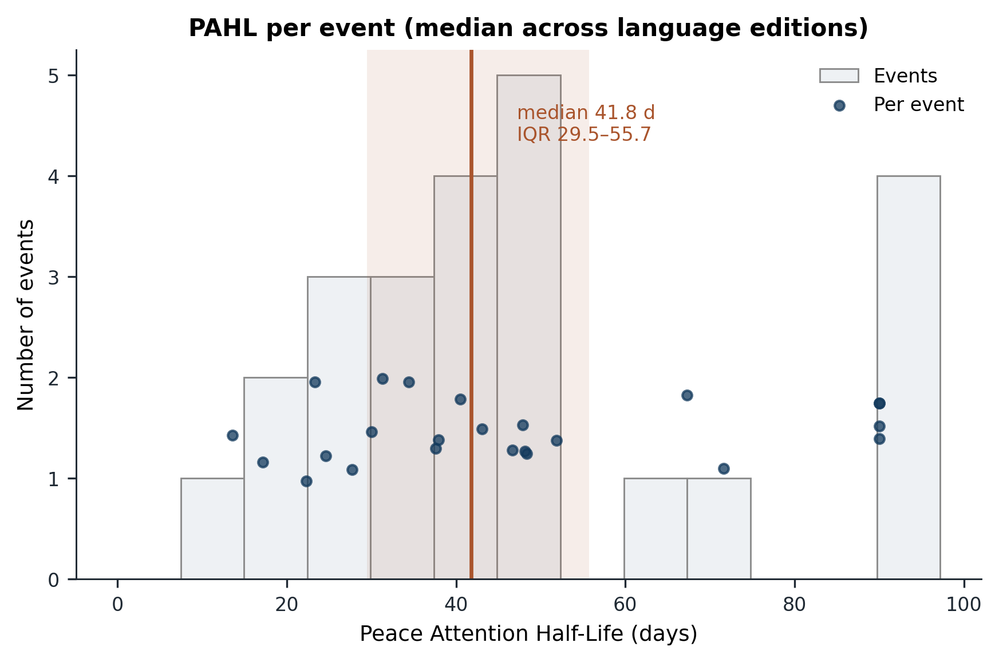
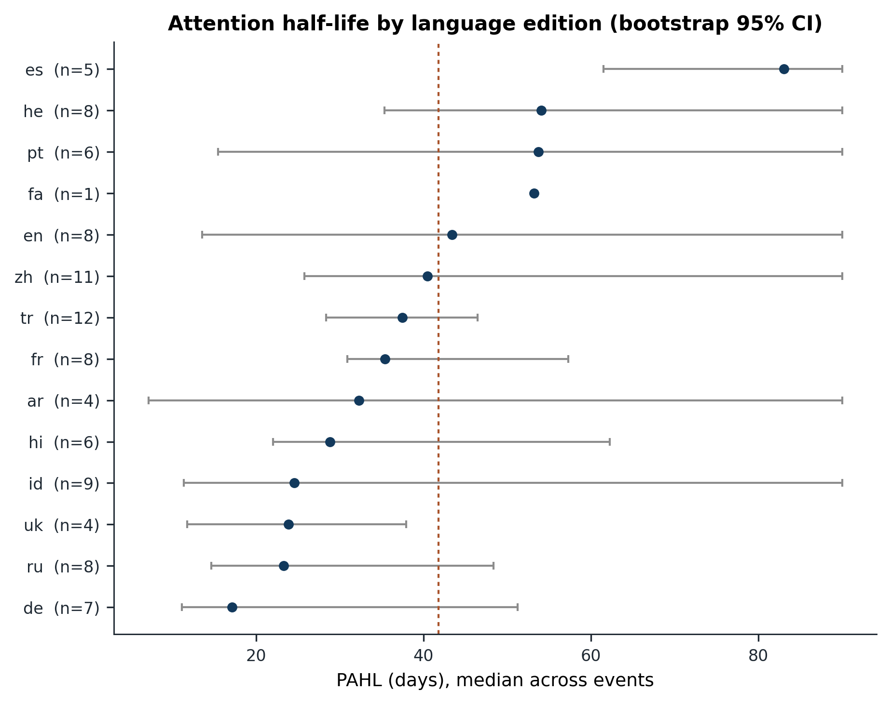
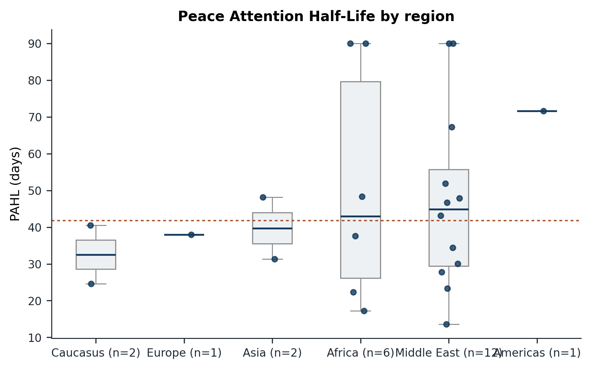
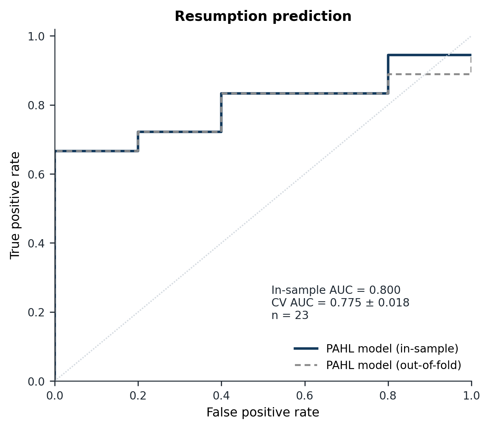
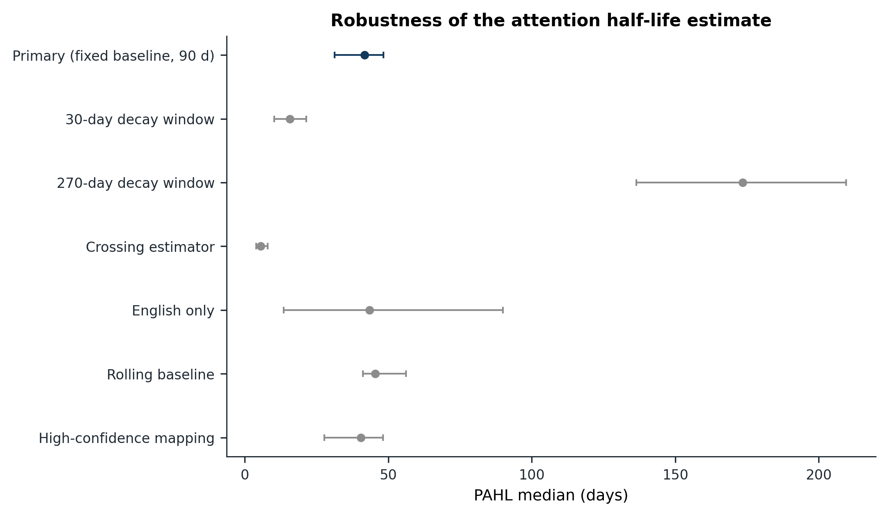

## Abstract

**Background.** Public attention is widely assumed to be part of what keeps a
ceasefire intact, and the issue-attention cycle predicts that attention to a
crisis rises, peaks and fades. The rate of that fade has not been measured for
international peace processes.

**Data and methods.** We transfer an established collective-attention decay
framework (Candia et al. 2019) to ceasefire announcements. We define the Peace
Attention Half-Life (PAHL), the number of days for attention in excess of a
pre-event baseline to fall to half of its post-announcement peak, and estimate it
for 36 verified ceasefires announced between 2015 and 2025 using daily Wikipedia
pageviews across 14 language editions. We adopt the violence-based outcome logic of the ceasefire-survival literature
(Clayton and Sticher 2021), code resumption from UCDP Georeferenced Event
Dataset fatalities, test both the announcement spike and the decay rate against
placebo dates, and test the decay rate against resumption within twelve months.

**Findings.** Attention spikes at announcement and then decays with a median
PAHL of 41.8 days (interquartile range 29.5 to 55.7; n = 24 of 36 events; 95 per
cent CI 31.3 to 48.4). Mean excess attention is 0.694 on the announcement day,
and its 7-day median peaks at 0.503 on the same day and falls to half that peak
by day 13. The decay rate is not event-specific. The observed median is
indistinguishable from, and shorter than, the median under random same-year
dates (55.3 days; one-sided empirical p = 0.926; two-sided p = 0.156). We
therefore read PAHL as the attrition schedule of attention to conflict content,
not as a ceasefire-specific response. War concepts received 2.65 times the
attention of peace concepts across editions and months (highest in Russian at
4.42, lowest in Hebrew at 1.64), with a trend of 0.0186 log units per year (95
per cent CI -0.0004 to 0.0375; p = 0.055). A one-standard-deviation longer PAHL
was associated with higher odds of resumption (OR 5.32, 95 per cent CI 0.74 to
38.21; n = 23; cross-validated AUC 0.775), but that interval is compatible with
no effect, only 5 events did not resume, and leave-one-out AUC falls to 0.667.

**Interpretation.** The world stops paying attention to a ceasefire on roughly
the same six-week schedule on which it stops paying attention to anything else,
and that schedule does not reliably predict which ceasefires hold. The announcement response itself is real; it is the decay that is generic. The
measurement and the cross-lingual ratio are the contributions, and the
predictive claim is exploratory.

## 1. Introduction

When a ceasefire is announced, the world looks. Cameras arrive, foreign
ministries issue statements, and newspapers in a dozen countries carry the same
photograph of two delegations shaking hands. Then the cameras leave. This paper
asks how fast they leave, whether the speed differs across the languages in
which people read about the war, and whether the speed carries information about
whether the ceasefire will hold.

That public attention matters to politics is not in dispute. The
issue-attention cycle describes how a problem emerges, commands urgency, and
fades (Downs 1972), and agenda-setting research shows that the salience media
assign to an issue is transmitted to publics (McCombs and Shaw 1972). In foreign
policy, the intensity of coverage changes the political cost of action and
inaction (Robinson 1999; Gilboa 2005; Baum and Potter 2008), and attention has
allocative consequences that can be measured: disaster relief responds to
whether a disaster happens to coincide with other newsworthy events, because
unrelated news crowds coverage of need out of the queue (Eisensee and Strömberg
2007). The other side of the same coin is documented neglect: most of the
world's conflicts go largely unreported, and the ignored ones are often the
deadliest (Hawkins 2011). Media attention has even been linked to how civil wars
end, with greater human-rights reporting associated with shorter wars and
negotiated settlements (Burgoon et al. 2015).

What this literature does not provide is a rate. It tells us that attention
rises and falls, that coverage is selective, and that coverage has consequences.
It does not tell us how quickly attention leaves a specific peace process, or
whether the speed at which it leaves is informative about what happens next.
Computational work on collective attention has established that such rates are
estimable: collective attention to cultural items follows a two-component decay,
a fast communicative component with a half-life of days and a slow cultural
component with a half-life of years (Candia et al. 2019), and the decay has
accelerated over recent decades (Lorenz-Spreen et al. 2019). Half-lives of
attention have been estimated for tweets (Pfeffer et al. 2023), for scientific
citation (Parolo et al. 2015), and for online content more generally (Wu and
Huberman 2007; Yang and Leskovec 2011; Lehmann et al. 2012). But this work has
not been applied to ceasefires, and it has never asked whether the decay rate
predicts a political outcome.

The distinction between estimation and prediction is the pivot of this paper.
The decay estimator we use is not ours. We adopt the collective-attention decay
framework of Candia et al. (2019) and apply it to a new event class, ceasefire
announcements. What we ask is what the resulting rate, estimated at
announcement, tells us about the resumption of violence. That question has a
particular practical form. The structural predictors that dominate the
ceasefire-durability literature, such as peacekeeping deployments, power-sharing
provisions, guarantees, and mediation, are largely observed after a settlement
is designed and implemented (Walter 2002; Fortna 2004, 2008; Hartzell, Hoddie and
Rothchild 2001; Hartzell and Hoddie 2003; Beardsley 2011). They are good at
explaining durability in retrospect and weak as real-time warning. Attention, by
contrast, is observable in public data at the moment of announcement, for
essentially every ceasefire, in every language edition, including in conflicts
with no peacekeeping mission and no coverage in the world's largest news
markets. If the rate at which attention leaves an agreement carries information
about whether the agreement holds, it is a cheap and widely available
early-warning signal, and that is the claim this paper tests.

Ceasefires are the right event class for the test for three reasons. They are
frequent: more than two thousand were recorded between 1989 and 2020 (Clayton et
al. 2022), and they are, as Bara, Clayton and Aas Rustad (2021) argue,
theoretically under-specified as a category, spanning tactical pauses,
humanitarian windows, and pre-negotiation devices. They are consequential:
ceasefire survival has been modelled against georeferenced fatality data, which
gives us an outcome that is measured independently of attention (Clayton and
Sticher 2021). And they are announcements, which is to say they have a date, a
moment at which attention could plausibly respond, which is exactly what an
event study needs.

The outcome variable, like the estimator, is adopted rather than invented. The
ceasefire-survival literature already models resumption of violence using
conflict-death data (Clayton and Sticher 2021), already provides a
population-level ceasefire dataset (Clayton et al. 2022), and already documents
that violations are near-universal, so that "collapse" must be defined by
intensity rather than by the existence of any violation (Sticher 2022). We adopt
that logic. Our contribution is the predictor, not the outcome.

To measure attention at the required resolution we use Wikipedia pageviews:
daily, free, unfiltered by platform algorithms, and available for the same
article across language editions. Pageviews have an established record as a
behavioural sensor, including for elections (Yasseri and Bright 2016), markets
(Moat et al. 2013), influenza (McIver and Brownstein 2014), and cultural memory
(García-Gavilanes et al. 2017), and cross-lingual attention on Wikipedia has
been mapped for event articles (Ruprechter et al. 2023; Gildersleve et al.
2023). What pageviews have not been used for, as far as we are aware, is
attention to armed conflict, and that is the application this paper tests.

The paper makes four specific contributions, none of which is a new estimator
or a new theory of durability. First, it provides the first estimates of an
attention half-life for ceasefire announcements, by transferring the decay
framework of Candia et al. (2019) to that event class. Second, it treats the
decay rate, rather than the level of attention, as an ex-ante lead indicator of
violence resumption, which inverts the way attention has been used in conflict
research: previously as a consequence of violence, now as a candidate predictor
of it. Third, it introduces the War-Peace Attention Ratio, a cross-lingual
measure of how much more attention a language edition devotes to war concepts
than to peace concepts, which allows the attention deficit to be compared across
language publics rather than asserted globally. Fourth, it uses Wikipedia
pageview data to measure attention to conflict, which to our knowledge has not
been done, and does so with a pre-specified article-set construction and a
published data pipeline so that the measurement can be audited and re-estimated.

Two conventions govern the interpretation throughout. The first is that the
paper is written in the register of early warning, not causal explanation: we
report whether a quantity observable at announcement carries information, not
why. The second is that the sign of the association is not obvious in advance.
One mechanism, which might be called accountability, predicts that longer-lived
attention raises the political cost of defection and hence predicts that the
ceasefire holds. Another, which might be called salience, predicts the opposite:
a quiet ceasefire generates little news, so rapid decay should accompany peace,
and attention should spike when an agreement breaks down (Galtung and Ruge
1965). The competing-expectations subsection states both expectations explicitly,
and the falsification subsection states what would count as evidence against
the design. We report whichever sign the
data produce.

The remainder of the paper is organised as follows. Section 2 situates the work
in the attention, ceasefire, durability, forecasting, and Wikipedia literatures,
and states precisely what is and is not new. Section 3 describes the three data
sources and the harmonisation required to join them. Section 4 sets out the
measures, the estimator, the outcome coding, the robustness checks, and the
conditions under which the central claims would fail. Section 5 reports results.
Section 6 discusses what they do and do not imply, Section 7 states limitations,
and Section 8 concludes.

## 2. Background and Related Work

### From the issue-attention cycle to a rate

The intellectual ancestor of this project is Downs's issue-attention cycle
(1972). Downs argued that public attention to a problem follows a characteristic
sequence: the problem leaps into prominence, remains there for a short time, and
then, though still unresolved, gradually fades from the centre of public
attention. Two features of the formulation matter here. The cycle is explicitly
about attention paid to a problem rather than the problem's severity: the fade
is driven by boredom, by the rising cost of further action, and by displacement
from new issues. And the evidence was impressionistic: Downs offered a stage
model, not a rate parameter.

The agenda-setting tradition grounded the first half of the claim empirically
(McCombs and Shaw 1972), and the news-values tradition specified the selection
rules that make some events reportable at all (Galtung and Ruge 1965).
Baumgartner and Jones (1993) and Jones and Baumgartner (2005) recast the cycle
as punctuated equilibrium: attention does not reallocate smoothly but lurches
between long periods of neglect and short bursts of salience, because
information processing is boundedly rational and issues compete for fixed
capacity. This literature is the source of the shape of our dependent variable.
It is a theory of why decay happens, not a measurement of how fast, and the
distinction is the one this paper tries to make operational.

### Attention decay as an estimable quantity

A separate and largely quantitative literature has estimated decay rates, mostly
on cultural, scientific, and platform data. The methodological precedent for this
paper is Candia et al. (2019), who use Wikipedia pageviews, search data, and
citation records to show that collective attention to cultural items follows a
universal bi-exponential decay: a fast communicative component with a half-life
of days, followed by a slow cultural component with a half-life of years, with
the weight shifting toward the slow component as an item ages. The theoretical
move that matters for us is the separation of a short-lived communicative memory
from a durable cultural memory, which maps naturally onto what we expect after a
ceasefire announcement: a spike, a rapid fade, and a residual baseline of
ongoing interest in a frozen conflict or a peace process.

That decay is itself changing is shown by Lorenz-Spreen et al. (2019), who find
that topics now receive shorter intervals of collective attention across
decades and domains, consistent with competition for finite attention under
rising content production. That decay rates are meaningful, field-varying
parameters is shown by Parolo et al. (2015), who estimate attention decay in
science and find systematic differences across fields. That half-life estimates
are sensitive to the operational definition is shown by Pfeffer et al. (2023),
who estimate a half-life for tweets and demonstrate the dependence of the number
on the definition used. The early results on novelty-driven spikes and on
characteristic temporal shapes are due to Wu and Huberman (2007) and Yang and
Leskovec (2011), and Lehmann et al. (2012) classify collective-attention
trajectories into distinct dynamical classes. Roediger and Abel (2015) connect
this computational work to the cognitive-science tradition of forgetting curves,
which is where the term half-life originates.

The implication for our design is precise and should be stated plainly. The
measurement machinery for PAHL is not new. Bi-exponential fits, half-life
estimation, and the distinction between fast and slow memory all exist, and we
adopt them. What does not exist, as far as we can determine, is an application
to ceasefire announcements as an event class, or a test of whether the resulting
rate has predictive value for a political outcome. PAHL is therefore a transfer
of an established estimator to a new event class, and the novelty subsection
states that concession in the same words used here.

### Attention to conflict: level, selectivity, and consequence

The CNN-effect literature asks whether coverage drives foreign policy.
Livingston and Eachus (1995) studied Somalia and concluded that the effect is
conditional: coverage mattered for when and how policy responded rather than
whether it responded. Robinson (1999) argued that the effect is strongest where
policy is uncertain, Gilboa (2005) reviewed the field and concluded that the
evidence supports a conditional, agenda-setting version of the thesis, and Baum
and Potter (2008) integrated the media, public-opinion, and foreign-policy
literatures into a single framework. Two findings from this tradition shape our
design.

First, selectivity is the norm and neglect has consequences. Hawkins (2011)
documents the other side of the CNN effect: most of the world's conflicts go
largely unreported, the deadliest are among the most ignored, and the
consequence of ignoring conflict is unchecked death tolls because neither policy
response nor humanitarian aid is forthcoming. Kinnick et al. (1996) and Moeller
(1999) name a mechanism, compassion fatigue, whereby repeated exposure to
distant suffering produces audience burnout and declining coverage. Kogen and
Price (2011) show that public opinion does not straightforwardly track coverage.
Second, attention has allocative consequences. Eisensee and Strömberg (2007)
provide the cleanest identification: US disaster relief depends on whether a
disaster coincides with other newsworthy events, which implies that relief is
driven by coverage and that unrelated news crowds coverage of need out. That is
the strongest existing evidence that attention is a real allocative variable
rather than an epiphenomenon.

The rally literature is the closest work on aggregate public response to
conflict events. Mueller (1970) established the rally phenomenon in presidential
approval data, and Baum (2002) disaggregated it by party and political
sophistication, showing that different audiences respond differently to uses of
force. That literature is an important boundary for us: it measures
individual-level opinion at monthly or event resolution, typically in a single
country, and it is about onset rather than decay. Our measures are
aggregate-attention measures, not opinion measures, and we do not claim to
measure support for peace.

Finally, a small literature uses media text as a predictor of violence rather
than as a consequence of it. Chadefaux (2014) shows that the tone and volume of
news reporting carry early-warning signal for war, and Mueller and Rauh (2018)
predict political violence from newspaper text with a transparent pipeline.
These are the closest precedents for treating a media-derived quantity as a
leading indicator, and they establish the evaluation conventions we adopt. They
use the volume or tone of reporting; we use the rate at which attention decays.

### Ceasefires as an object, and an outcome we adopt rather than invent

Ceasefires have only recently become a research object in their own right. Bara,
Clayton and Aas Rustad (2021) note that ceasefires are ubiquitous, with more
than two thousand recorded between 1989 and 2020, and theoretically
under-specified: they can be tactical, humanitarian, or pre-negotiation devices.
Clayton, Nathan and Wiehler (2021) argue that ceasefire success is itself
under-conceptualised and must be assessed on more than one dimension. Clayton
and Sticher (2021) provide the theoretical core, distinguishing logics of
ceasefire design generated by different bargaining problems, and they model
ceasefire survival using agreement provisions and georeferenced event data with
conflict deaths as the measure of whether a ceasefire remains in place. Sticher
(2022) reviews why violations occur and finds them near-universal, which
implies that an outcome must be defined by intensity thresholds rather than by
the occurrence of any violation at all. Lundgren, Svensson and Karakuş (2023)
analyse one hundred and forty-five local ceasefire agreements in Syria using
interrupted time series and spatial panel models on georeferenced violence data,
finding that local ceasefires can trigger either escalation or de-escalation.
Karakuş and Svensson (2017) study partial ceasefires in the same war, Åkebo
(2016) provides the comparative case-study treatment, and Bell and Badanjak
(2019) supply the coded text of agreements through the PA-X database.

Two consequences follow for our design. First, the outcome we measure is not
novel: it is the standard violence-resumption outcome of this literature, and
we adopt it explicitly. Second, the natural sampling frame for a study of
ceasefires already exists. What exists for the coverage of individual ceasefires
is qualitative and single-case (Murua and Ramírez de la Piscina 2017): framing
analysis of one agreement's press, with no time series, no decay rate and no
predictive test. Clayton et al. (2022) introduce a population-level
dataset of more than two thousand ceasefires across sixty-six countries and one
hundred and nine civil conflicts between 1989 and 2020, coded for actors, class,
purpose, coverage, and end date. We do not use that dataset as our sample, and
we say so plainly. Our design imposes three additional requirements that the
population-level dataset does not satisfy: a verified date on which an
announcement can be aligned with a daily attention series, a conflict-specific
article set that exists in a substantial number of language editions, and
sufficient pageview volume to estimate a decay rate. We therefore curate a
smaller sample and document the inclusion rules in the data section. The sample is
not representative of ceasefires in general, and the limitations section
treats that as a limitation rather than a design feature.

### Durability, structure, and the early-warning gap

The durability literature supplies the outcome side of this paper and its main
theoretical rivals. Fortna (2004, 2008) shows that peacekeeping substantially
lengthens the duration of peace after civil war and addresses the non-random
deployment of peacekeepers; Walter (2002) explains settlement and durability in
terms of credible commitment, with settlements failing when belligerents cannot
commit not to exploit the other's demobilisation; Hartzell, Hoddie and Rothchild
(2001) and Hartzell and Hoddie (2003) show that institutionalised power-sharing
is associated with more durable peace. Beardsley (2011) argues that mediation
buys agreements at the price of durability, which is a direct precedent for the
structure of our hypothesis: a feature of the settlement environment predicts
collapse. Kreutz (2010) disaggregates conflicts into termination episodes and
provides the canonical treatment of how conflicts end, Hultman (2010) and
Hultman, Kathman and Shannon (2013) study whether peace operations reduce or
spur violence against civilians, and Hultman and Mousa (2025) review the
integrated evidence on peacemaking and peacebuilding.

This literature is rich in structural predictors, and they are uniformly
measured on the violence or agreement side. In none of these works is public
attention a variable, let alone a predictor. That is not an oversight so much as
a consequence of what was measurable: attention to a specific agreement was not
observable at daily resolution across many countries until the relevant digital
traces became available.

The corollary is a gap that the early-warning literature cares about. Forecasting systems such as ViEWS produce monthly country- and subnational predictions
from structural and violence data (Hegre et al. 2019), and Ward, Greenhill and
Bakke (2010) argue that conflict research should be evaluated by predictive
performance rather than statistical significance. Structural predictors are
excellent for both of those purposes in retrospective analysis, but most are
known only after a settlement has been designed and implemented, which limits
their value at the moment when a warning would matter. An attention-based
quantity is available at that moment. Whether it is informative is an empirical
question, and that question is the one this paper tests.

### Wikipedia pageviews as an attention instrument

Wikipedia pageview data have an established record as a behavioural sensor.
Spoerri (2007) was among the first to analyse what is popular on Wikipedia and
why, establishing that pageview distributions are extremely skewed and
event-driven. Moat et al. (2013) show that Wikipedia usage patterns carry
information about forthcoming stock-market moves; McIver and Brownstein (2014)
show that Wikipedia usage estimates influenza-like-illness prevalence in near
real time; Tizzoni et al. (2020) show that news exposure shapes collective
attention during an epidemic; Yasseri et al. (2012) use Wikipedia to study
conflict and coordination in collaborative editing; and Yasseri and Bright
(2016) provide the most careful methodological treatment of pageviews as a
measure of public attention, and are explicit about the assumptions required,
including that a pageview is a measure of curiosity rather than of support.

Three results in this canon are cautions rather than endorsements, and we adopt
them as such. García-Gavilanes et al. (2016) show that the characteristics of an
event shape its attention trajectory, using aircraft crashes as the test case.
García-Gavilanes et al. (2017) show that collective memory of past events decays
but is reactivated by commemoration, which is a direct threat to a monotone
decay assumption: ceasefires with anniversaries and diplomatic follow-ups will
generate secondary attention, and a single exponential fit will absorb that
into noise or into a biased rate. Ruprechter et al. (2023) analyse attention to
event articles across four Wikipedia language editions and show that attention
and coverage are skewed toward events in economically developed countries and
toward more severe events, which is a direct caution that cross-lingual
comparisons may partly measure who has broadband rather than who cares.
Gildersleve et al. (2023) show how networked topics of collective attention can
be identified on Wikipedia and how current events are integrated into the
encyclopaedic structure, which is the methodological precedent for building an
article set rather than picking one. Ciampaglia et al. (2015) frame the
underlying allocation problem: information production competes for finite
attention.

The existing applications of pageviews are elections, markets, disease,
disasters, cultural memory, and general event attention. We found no study that
uses pageviews to measure attention to armed conflict or to ceasefires. That is
the application this paper makes, and it comes with the construct caveats above
rather than despite them.

### What is new, and what is not

The novelty claim of this paper is narrow, and it is worth stating what we do
not claim. We do not claim a new decay estimator: the estimator is Candia et
al.'s (2019), and we transfer it. We do not claim a new outcome: the outcome is
the violence-resumption outcome of the ceasefire-survival literature (Clayton
and Sticher 2021), and it is measured with the standard georeferenced fatality
data (Sundberg and Melander 2013). We do not claim a new ceasefire dataset: a
population-level ceasefire dataset already exists (Clayton et al. 2022), and we
use a curated subsample with documented inclusion rules. We do not claim that
attention decay is unknown: it is established for cultural items, tweets,
science, and news.

What we do claim is a conjunction of four things. First, an attention half-life
estimated for ceasefire announcements at all. Second, the decay rate, as
distinct from the level of attention, used as an ex-ante predictor of violence
resumption, which is a different statistical role from the descriptive role the
decay literature has assigned to it. Third, a cross-lingual War-Peace Attention
Ratio: no prior work constructs a war-versus-peace attention contrast at all,
and no prior work does so across language editions, although cross-lingual
comparison of Wikipedia event attention is established as feasible (Ruprechter
et al. 2023; Gildersleve et al. 2023). Fourth, the use of Wikipedia pageviews to
measure attention to armed conflict and peace processes.

Our negative claims are claims about the published, indexed literature as of
November 2026, not proofs of absence. We searched OpenAlex, Crossref, and
Semantic Scholar using co-occurrence queries pairing ceasefire terms with
Wikipedia, pageviews, media attention, and attention decay, and we inspected the
reference lists of the most recent reviews in the area (Bara, Clayton and Aas
Rustad 2021; Hultman and Mousa 2025); the queries are recorded in the
repository. Preprints, non-English scholarship, and practitioner monitoring
reports may exist outside those indexes. We therefore write "we are not aware
of" rather than "no study exists", and we invite correction.

### Competing expectations and the sign of the association

The central association in this paper is between the rate of attention decay and
the resumption of violence. Two mechanisms make opposite predictions, and a
paper that reported whichever sign appeared without having stated both would be
uninterpretable.

The accountability mechanism treats attention as an enforcement resource. If
political costs of defection depend on being seen, then sustained attention
after an announcement raises the cost of violating the agreement, and a longer
half-life should predict a lower hazard of resumption. On this account the
decay rate is a proxy for the durability of the enforcement environment, and the
pre-registered directional expectation of the project is the negative one: a
longer PAHL predicts a lower probability of resumption.

The salience mechanism treats attention as a symptom. News value is driven by
drama, novelty, and violence (Galtung and Ruge 1965); a ceasefire that works
produces no dramatic events, and a ceasefire that collapses produces them. On
this account rapid decay should accompany peace, the level of attention should
spike before breakdown rather than protection, and the association could run in
the opposite direction to the accountability prediction. The two mechanisms are
not mutually exclusive, and a null result is a third possibility.

Three design features make the two mechanisms distinguishable in principle. We
separate the rate from the level: two ceasefires can have identical
announcement-day attention and very different half-lives, so an association
between PAHL and resumption is not an association between attention volume and
resumption. We control for pre-announcement violence intensity, which is the
most obvious confound of both mechanisms. And we test the rate against placebo
dates, which addresses the concern that any decaying series would produce a
"half-life" of the same magnitude. We state the directional hypothesis but
report whichever sign the data produce, and the falsification subsection lists
the outcomes that would count against the framework.

## 3. Data

### Attention: Wikimedia pageviews

Attention is measured with daily pageview counts from the Wikimedia Analytics
Query Service, which publishes, for every article in every language edition, the
number of requests classified as user traffic on a daily basis from 1 July 2015
onward (Wikimedia Foundation 2024). For each language and article we retrieve the
complete daily series for 1 July 2015 to 1 November 2025, so that every event in
the sample has a pre-announcement baseline of several months and, for events near
the end of the period, a shorter but usable follow-up. Requests are made per
article and cached to disk, with retry and backoff on rate limiting, so that
retrieval is resumable and the resulting series are identical on re-run, giving
1736563 raw pageview rows.

Article selection proceeds in two concept families and one event-based set. The
war family consists of ten English Wikipedia articles denoting armed conflict and
its instruments: War, Armed conflict, Civil war, Invasion, Airstrike, Genocide,
Terrorism, Military occupation, Refugee, and War crime. The peace family consists
of eleven articles denoting the institutions and practices of peacemaking: Peace,
Ceasefire, Peace treaty, Peacebuilding, Mediation, Diplomacy, Reconciliation,
Disarmament, Demobilization, Peacekeeping, and Humanitarian aid. The two families
support the War-Peace Attention Ratio and a family-level comparison of decay
rates. The event-based set consists of conflict-specific articles, one or more
per event in the ceasefire table, resolved from the English article for the
relevant war; these support the event-level PAHL estimates. Fifty canonical
articles were carried into the panel.

For each English seed article we resolve the corresponding title in each of
fourteen target language editions - Arabic, Chinese, English, Persian, French,
German, Hebrew, Hindi, Indonesian, Portuguese, Russian, Spanish, Turkish, and
Ukrainian - through the MediaWiki langlinks API rather than by hand translation.
The fourteen editions span the theatres of the conflicts in the sample (Arabic,
Hebrew, Russian, Ukrainian, Persian, Turkish) and the principal mediator and
donor-language publics (English, French, German, Spanish, Portuguese, Chinese,
Indonesian, Hindi). Where no langlink exists, the article is treated as not
existing in that edition and no series is created. Such absences are structural,
reflecting editorial coverage rather than zero readership, and coding them as
zero attention would confound non-existence with inattention; the panel is
therefore unbalanced by construction. Titles are normalised and URL-encoded
before requests, and views to title variants that redirect are not aggregated
into the canonical title, which is a known and documented measurement loss.

The resulting panel contains 644 article-language series, of which 630 have
usable pageview data, across 14 language editions and 3777 days, giving 1685694
positive daily observations. A further 643612 panel cells are missing because
the corresponding article did not yet exist at that date; 307 series have
partial coverage. Existence is handled temporally, since pageview rows begin
when an article is created or renamed, so days before an article's first
pageview are treated as missing rather than as zero attention.

### Ceasefires: a curated and verified event table

We curate a table of ceasefire, truce, cessation-of-hostilities,
de-escalation, and peace-agreement events announced between 2015 and 2025. An
event is included if it was announced for a civil war, interstate conflict, or
sustained non-international armed conflict with an identifiable theatre country;
applied to the conflict as a whole or to a substantial geographic component of
it rather than to a single local encounter; received regional or global news
coverage, so that a cross-language attention response is plausible; and can be
dated to a day by at least one authoritative source that states the date
explicitly.

Events are excluded if the announcement was never implemented and no
implementing date can be identified, if the instrument was a purely tactical
pause with no public announcement beyond a local agreement, or if the date
cannot be verified against an independent source. Where announcement and entry
into force differ materially, we use the date of the public announcement or
entry into force, because that is the moment at which attention is expected to
react; the choice is recorded for every event. Each record carries a stable
identifier, the date, the theatre country (ISO3), the conflict name, the
participating actors, an instrument type drawn from five categories (ceasefire,
humanitarian pause, peace agreement, truce, and de-escalation), an
expected-salience label, at least one source URL, and a verification flag that is
set only after the date has been checked against the source text.

The verification discipline matters more than it might appear. Several of the
most widely cited ceasefires in this period have dates that differ across
reporting conventions by days or weeks, and misaligning the clock would corrupt
every downstream estimate. Where a widely used alternative convention exists, the
event-study analysis reports results under both the verified date and that
convention.

This sampling strategy departs from the population-level ceasefire dataset of
Clayton et al. (2022), and the departure is a deliberate compromise. Their
dataset is the appropriate frame for questions about ceasefire frequency and
design; it is not sufficient for a daily attention panel, because it does not
guarantee a verified announcement date, a conflict-specific article set in many
language editions, or sufficient pageview volume. We trade representativeness
for measurability and treat the sample as a sample rather than as the population.

The final table contains 36 events across twenty theatre countries, spanning
February 2015 to July 2025. Twenty-four are classified as ceasefires, 7 as
peace agreements, 2 as humanitarian pauses, 2 as de-escalation arrangements and
1 as a truce; eighteen were expected to be high-salience, thirteen medium and
five low. Every event carries a verified date and at least one source that states
it. Events are not lost at verification; they are lost later, at the mapping and
estimation stages described in the sample-description subsection.

### Violence: UCDP Georeferenced Event Dataset

Outcomes are measured with version 26.1 of the Uppsala Conflict Data Program
Georeferenced Event Dataset, which records individual organised-violence events
with date, location, actors, and a best fatality estimate (Sundberg and Melander
2013; UCDP 2024), and which is the standard violence measure in the ceasefire
literature whose outcome logic we adopt (Clayton and Sticher 2021). The
aggregation method and the annual update are documented by Davies, Pettersson and
Öberg (2022). We aggregate events to monthly total fatalities by country for the
theatre-level resumption definition, and by conflict dyad for a conflict-specific
alternative, giving 5782 country-month and 20443 dyad-month rows. The extraction
covers 2014 through 2025, one year longer than the event table at the start, so
that every event in the sample has a pre-announcement baseline of at least six
months.

Two features of the source affect the join. GED records the country in which an
event occurred rather than the theatre of the war, so events in Gaza appear under
Israel; we follow the documented proxy join instead of assuming that theatre
codes and GED labels coincide. And, as with any event-based fatality data, the
series reflects reporting coverage as well as violence; we use it as a relative
rather than an absolute measure and define outcomes in terms of ratios to a local
pre-event baseline rather than absolute counts.

### Harmonisation

Joining the three sources requires three mappings: from ceasefire event to
theatre country ISO3 code; from theatre country to the monthly UCDP series; and
from event to the set of article series whose attention is expected to respond.
The first is straightforward for events with a single theatre and is recorded
explicitly for the small number of multi-theatre events. The second is direct
for country-level series. The third is the only one requiring judgement: an
event is matched to the conflict-level article for its war where one exists, and
to regional coverage where the conflict has no dedicated article in a given
language. We record the matching explicitly, so that every PAHL estimate can be
traced to a specific article and language.

Time is handled in the natural time zone of the event for the alignment of the
announcement to a calendar day, and all decay windows are defined in elapsed
days from the event date. Missing pageview days inside an article's existence
period are filled with zeros, which is correct for a series that counts
requests; days before an article's creation are not filled, because a zero would
misrepresent non-existence as inattention.

### Sample description

The final analytic sample contains 36 ceasefire events covering twenty theatre
countries, announced between February 2015 and July 2025. Of these, 34 were
mapped to a conflict article covering the theatre and 24 produced a usable
half-life; 2 could not be mapped because the article universe contains no
dedicated conflict article, and 10 mapped events produced no usable fit because
too few language editions yielded a valid decay. Table 1 summarises the three
sources.

Table 1. Data sources and analytic sample.

| Source | Unit of observation | Resolution | Coverage | Volume |
|---|---|---|---|---|
| Wikimedia pageviews | article x language x day | daily | 2015-07-01 to 2025-11-01 | 1736563 rows; 644 series; 1685694 observations |
| Curated ceasefire table | event | event | 2015-2025 | N = 36 events |
| UCDP GED v26.1 | fatality event, aggregated | event to month | 2014-2025 | 5782 country-months; 20443 dyad-months |

The events without a usable half-life are not missing at random. The dominant
mechanism is that the conflict article did not exist before the announcement, so
that no pre-event baseline can be measured, or that the announcement produced no
measurable attention spike. The panel therefore under-represents sudden new wars
relative to long-running conflicts. We report this as a property of the design
rather than imputing estimates for the missing events, and the limitations
section treats it explicitly.

### Licensing, ethics, and provenance

All three sources are public. Wikimedia pageview data are published under
Wikimedia's open data policy and the underlying encyclopaedia text under
CC BY-SA; the study uses only aggregate request counts and no individual-level
data (Wikimedia Foundation 2024). UCDP data are distributed for research use
with citation; we cite the dataset and its version in the data availability
statement (UCDP 2024). The curated ceasefire table is released with this paper
under CC BY 4.0, with every row traceable to a URL. No human subjects are
involved, no personal data are processed, and no information is used that is not
already public. Retrieval dates, API endpoints, and file hashes are recorded in
the repository so that the frozen dataset can be reconstructed.

## 4. Methods

### Measures

Attention is defined on the log scale, A = log(1 + V), because view
distributions are strongly right-skewed and because a constant proportional
decline is the natural object for a half-life. Two baselines are used, and the
distinction matters for reading the paper.

The pre-event baseline is the median of A over the window from day -90 to day
-30 relative to the announcement, requiring at least 15 observed days. It is a
fixed reference level into which no post-announcement attention can enter. The
rolling baseline is the 28-day centred mean of A with the fourteen days on
either side of the announcement masked, the masked window filled from the
pre-event median, and the series edges interpolated. It follows the logic of the
original project design and tracks slow drift in attention across the year.

Excess attention is E = A - baseline. Because A is a log and the baseline is a
summary of logs, E is approximately the log ratio of views to the reference
level: E = 0 means attention at its pre-announcement level, and E = log(2)
corresponds to a doubling. The event-study curves use the rolling baseline,
because it removes the announcement contamination while preserving the trend;
the PAHL fits use the pre-event baseline, because a half-life is only
interpretable against a fixed reference level. The two definitions are compared
directly in the robustness checks, where substituting the rolling for the
pre-event baseline moves the median half-life from 41.8 to 45.4 days.

### Event-study design

Each ceasefire is aligned at t = 0 on its verified announcement date. For each
event and each matched article series we compute excess attention for t in
[-90, +365], a window long enough before the event to characterise the
pre-announcement level and long enough after it to observe a full decay for all
but the very slowest cases. Series are included for an event if the article
existed at t = 0, as indicated by a langlink. Days outside an article's
existence are excluded rather than zero-filled.

The primary event-study object is the mean excess attention by day from t = 0,
computed across all event-series pairs and then smoothed with a centred 7-day
median, because daily pageview series carry strong weekly structure. Two caveats
shape the interpretation. Because events differ enormously in salience, the
pooled mean is dominated by the largest events; we therefore report both the
pooled curve and event-level curves, and never interpret the pooled peak as
representative of a typical ceasefire. And because attention before t = 0 is not
zero, the pooled curve includes a pre-period that can reveal anticipation and
pre-existing trends, which we inspect rather than assume away.

The peak of the pooled curve is the day of maximum smoothed mean excess in the
post-announcement period, and the half-peak day is the first day after the peak
at which the curve falls to half the peak value. The event-level peak used for
PAHL is located separately by the estimator described next. Events with no
detected response are reported rather than dropped: 34 of the 36 events
contribute to the pooled curve.

### Peace Attention Half-Life: an adopted estimator

PAHL is defined as the number of days for excess attention to fall to half of
its post-announcement peak. The estimator follows the collective-attention decay
framework of Candia et al. (2019), whose central result is that collective
attention decays in two components: a fast communicative component with a
half-life of days and a slow cultural component with a half-life of years. For
each event and language edition with usable data, log attention is smoothed with
a centred 7-day median. The peak is the day of maximum smoothed attention in the
14 days after the announcement, accepted only if it exceeds the pre-event
baseline by a pre-specified minimum amplitude, so that series without a
measurable spike cannot generate a spurious half-life. The decay is then fitted
from the day after the peak to ninety days after the peak, on those days whose
excess attention is above 5 per cent of the peak excess, requiring at least 10
fitting points.

On those days we estimate the slope of log excess attention against days since
peak by the Theil-Sen estimator, the median of all pairwise slopes, and take
lambda as minus that slope, so that PAHL = ln(2) / lambda. Theil-Sen is used in
place of least squares because announcements, violation spikes and anniversaries
generate secondary bumps that a least-squares fit would allow to dominate; a
Huber M-estimate is computed as a sensitivity. Half-lives longer than the
fitting window cannot be resolved and are right-censored at 90 days and flagged,
so every summary is a mixture of resolved and censored fits and is reported
alongside the censored fraction.

The event-level estimate is the median across language editions with a valid
fit, with a minimum of one edition for the main analysis and a multilingual
subset requiring at least two. Uncertainty in the cross-event median is
characterised by a cluster bootstrap over events with 2000 resamples; per-event
uncertainty is characterised by the spread across editions and by the censored
fraction. Fit failures are recorded with a reason code and reported, and 12
events produced no usable estimate.

Two features of the specification are deliberate concessions. The estimator is a
single exponential with no offset, not the full two-component model of Candia et
al. (2019): over a one-year window the fast component dominates, but the slow
component is therefore not separately identified, and residual slow drift can
bias lambda upward. And the fit conditions on a spike having been detected,
which excludes events whose attention response was absent or negative.

### Functional form and the sensitivity of the half-life

A single exponential is a lossy description of attention to a ceasefire. The
true trajectory is likely to be multimodal, with an announcement spike,
violation-driven spikes, diplomatic follow-ups, and anniversary effects;
García-Gavilanes et al. (2017) show that commemoration reactivates attention to
past events, which violates monotone decay by construction. Pfeffer et al. (2023)
show that half-life estimates move with the operational definition. We therefore
treat PAHL as a descriptive summary with an error bar rather than as a structural
parameter, and we make its instability visible in four ways: the decay window is
varied across the alternatives reported in the robustness section; per-event
estimates are reported individually; a non-parametric half-peak crossing
estimate is computed as a check that does not assume an exponential form; and
events that cannot be fitted are counted and reported rather than imputed.

The primary window and the censoring horizon are the same 90 days, so the
headline median is partly a property of the horizon rather than of the data. The
censored fraction of 0.233 is therefore reported alongside every summary, and the
window comparison in the robustness section shows how the median moves from
15.7 days at a 30-day window to 173.5 days at a 270-day window. A number that
moves that much is a summary, not a constant of nature, and it is presented as
one.

### War-Peace Attention Ratio

WPAR is defined monthly and per language as the ratio of total attention to the
war family to total attention to the peace family:

    WPAR(l,m) = sum over war articles of V / sum over peace articles of V

computed on raw views, so that it has a direct interpretation as how many reads
the war concepts receive for every read of the peace concepts. Because the ratio
is a level measure whose absolute value depends on the number and popularity of
articles in each family, the statistical analysis is conducted on log WPAR and
interpreted as relative change over time within a language and as differences in
trend across languages; we do not interpret the absolute level as a measure of
public sentiment.

Trend is estimated by OLS of log WPAR on a monthly time index with Newey-West
HAC standard errors (twelve lags). Seasonality is characterised by the range of
month-of-year effects, and cross-language dispersion by the monthly interquartile
range of WPAR across the 14 editions. We report the highest and lowest median
ratio by language. Two caveats bound the interpretation: family composition is
not perfectly comparable across editions, because the article sets differ, and
cross-lingual attention comparisons partly reflect connectivity and coverage
differences rather than differences in interest (Ruprechter et al. 2023). A
language's ratio is a property of its edition's readership, not of its public.

### Outcome coding: resumption of violence

A ceasefire is coded as having resumed if, within twelve months after the event
date, monthly fatalities in the theatre country exceed 25 per cent of the mean
of the six months preceding the event for at least two consecutive months. The
ratio-based definition is deliberate: absolute fatality thresholds would
classify every ceasefire in a high-intensity war as failed and every ceasefire in
a low-intensity conflict as successful. Requiring two consecutive months
prevents a single atrocity or data artefact from driving the outcome, and the
intensity-threshold approach follows the standard in the ceasefire literature,
where violations are near-universal and collapse is defined by escalation rather
than by violation (Sticher 2022; Clayton and Sticher 2021). The primary analysis
uses the country-level series; a dyad-level variant is reported as a robustness
check. Time to resumption is measured in months from the event date to the first
month of the qualifying pair, censored at twelve months for ceasefires that
hold. Alternative thresholds and a three-consecutive-month variant are reported
in the robustness checks. We report the base rate of resumption before any modelling,
because with a small sample the base rate is more informative than any
coefficient.

### Predictive models and evaluation

The predictive question is whether PAHL carries information about resumption
beyond what is already known at the time of the announcement. The primary
specification is a univariate logistic regression of resumption on standardised
PAHL. A ridge-penalised adjusted model adds log pre-event monthly fatalities,
agreement type and region fixed effects; penalisation is used because with
roughly forty events a maximum-likelihood model with twelve parameters is not
stably estimable, and the adjusted coefficients are therefore shrunk and their
Wald intervals approximate. Coefficients are reported as odds ratios with 95 per
cent confidence intervals, together with the sample size and the number of events
in each outcome category.

Discrimination is reported three ways: in-sample AUC, repeated stratified 5-fold
cross-validated AUC over 200 repeats, and leave-one-out predictive AUC. We treat
the cross-validated and leave-one-out values as the honest ones and report the
in-sample value only so that the optimism gap is visible. A Cox
proportional-hazards model for time to resumption in months, censored at twelve,
with the same covariates is reported as a survival variant, with hazard ratios
and a proportional-hazards check. The evaluation conventions are those of the
early-warning literature: predictive performance rather than statistical
significance is the criterion (Ward, Greenhill and Bakke 2010; Hegre et al.
2019), and no information from after the announcement enters the predictors.

The inference is exploratory and underpowered. With 18 positive and 5 negative
outcomes, a single event moves the estimates substantially, and a confidence
interval that includes one is not evidence of an effect. We report effect sizes
and intervals as the primary quantity and treat p-values as descriptive.

### Robustness and specification checks

Six families of checks are pre-specified and reported regardless of outcome.
First, placebo events: for each ceasefire we draw 500 pseudo-event dates
uniformly from the same calendar year inside the available data and push each
through the identical pipeline, so that the placebo inherits the baseline, the
peak search, the smoothing and the censoring. The event-level null is the median
across language editions, and the study-level null draws one placebo half-life
per event and takes the cross-event median. This yields 8236 placebo fits and an empirical p-value for the observed median
in both tails, and it is the single most important check in the paper: if
attention around ceasefires decays no differently from attention around
arbitrary dates in the same years, the event-specific interpretation fails.

The same placebo construction is applied to the announcement response itself.
Peak excess is extracted for each observed event and for each pseudo-event date
in the same way, and the observed cross-event median is compared with the
distribution of cross-event medians under the placebo. This tests a different
claim from the decay placebo: whether attention rises more on ceasefire dates
than on arbitrary dates, rather than whether it subsequently decays differently.
The two tests are reported side by side so that neither is mistaken for the
other.

Second, alternative decay windows at 30 and 270 days after the peak, a
non-parametric half-peak crossing estimator that does not assume an exponential
form, and a variant that fits on excess over the rolling rather than the
pre-event baseline. Third, resumption thresholds at 10 and 50 per cent of the
pre-event mean in place of the primary 25 per cent, each requiring two
consecutive months. Fourth, leave-one-out: the cross-event PAHL median and the
predictive AUC are recomputed with each event omitted in turn, to identify
whether a single ceasefire drives the results. Fifth, a permutation test in which
the resumption outcome is permuted 1000 times and the ridge-logistic coefficient
on PAHL is refitted each time, giving a null distribution for the association,
with the Spearman permutation reported alongside. Sixth, language subsets:
English-only against the multilingual-only subset of events with at least two
editions, which separates a global-attention result from one carried by the
largest edition.

Two further checks bound the mapping and the multiplicity. Restricting to events
mapped by exact or high-confidence name, which drops country-only and
multi-candidate fallbacks, re-estimates the median on a smaller sample. And
because the paper reports several hypothesis tests, we apply Benjamini-Hochberg
adjustment across the ten main tests and report how many survive at a 5 per cent
false-discovery rate; with a small sample this is a check on the strength of
the overall claim rather than a substitute for the confidence intervals.

### Falsification conditions

The design specifies conditions under which the framework would be rejected, and
the results resolve them into two claims with different answers. Claim A, that
the announcement response is event-specific, holds at the raw level: the spike
placebo gives a one-sided p of 0.0060, although q = 0.060 after correction and
only 5 of the 27 events beat their own null individually. Claim B, that the decay
rate is event-specific, fails: the decay placebo gives a one-sided p of 0.926 and
a two-sided p of 0.156, and the observed median is shorter than the null. The
PAHL-resumption association survives permutation before correction, with a raw p
of 0.033 and an adjusted p of 0.109, and the cross-validated AUC is above chance.
The war-versus-peace direction is that peace decays more slowly, which reverses
the attention-deficit framing that motivated the ratio.

A further condition applies to direction: if the association changed sign
between the primary specification and its alternatives, its direction would be
unidentified. The direction does not change across the alternatives we report,
but the 50 per cent threshold attenuates the magnitude substantially, and we
report that attenuation rather than selecting the favourable window.

### Reproducibility

The pipeline is a single Python codebase with a one-command reproduction path.
Retrieval is cached and resumable, so a re-run reconstructs the frozen datasets
from the recorded endpoints without depending on live API availability; the
analysis and figure stages regenerate every number and every figure from the
cached data with fixed random seeds. Versions of the data sources, the retrieval
date, and the analysis code are recorded in the repository, and a separate
verification script checks that each numeric claim in the manuscript matches the
machine-readable results file. Code is MIT-licensed and data and manuscript are
released under CC BY 4.0, so that the measurement can be criticised, extended,
or re-estimated with different thresholds.

### Interpretational stance

Nothing in this design identifies a causal effect. Attention and violence are
jointly determined: a ceasefire that is visibly collapsing generates both
attention and fatalities, and a conflict that is quiet generates neither. The
estimates in this paper are descriptive (how fast does attention decay, and how
does that differ across events and languages) and predictive (does the decay
rate carry information about resumption). Where we use the language of
association, we mean association. Where the results are consistent with an
enforcement mechanism, we say so and we say that the salience mechanism is
equally consistent. The purpose of the exercise is to establish that the
quantity can be measured, to show what its measurement implies, and to leave a
reproducible instrument for others to test.
## 5. Results

### The attention response to ceasefire announcements

Of the 36 events, 34 were mapped to a conflict article and contribute to the
pooled attention curve; the remaining 2 have no conflict-specific article in the
article universe. The response is unmistakable at the aggregate level, but the
number depends on which series is read. The unsmoothed daily cross-event mean
excess attention is 0.694 on the announcement day. The 7-day centred median of
that curve, which is the series used to locate the peak, peaks at 0.503 on the
announcement day and reaches half of that peak by day 13 (Figure 1); using the
fixed pre-event baseline instead puts the half-peak day at 14. After the first
month the smoothed curve is indistinguishable from its pre-announcement level
and stays there for the remainder of the year.

The event-level heatmap (Figure 5) shows why the pooled peak is not a typical
event. A small number of announcements generate very large spikes, including
Colombia 2016 (peak excess 2.70 in the fitted series), Nagorno-Karabakh 2020
(3.43) and Nagorno-Karabakh 2023 (2.98), while many others produce barely
distinguishable bumps. The pooled mean is therefore a description of the
aggregate response, not of a typical ceasefire, and the median half-life
reported below is a better summary of the typical case.

### The distribution of the Peace Attention Half-Life

Fitting the post-peak decay for each event and language edition yields 24
event-level estimates. Median PAHL is 41.8 days (interquartile range 29.5 to
55.7; mean 46.9, SD 24.1; range 13.6 to 90.0), with a cluster-bootstrap 95 per
cent confidence interval for the median of 31.3 to 48.4 from 2000 resamples. The
distribution is right-skewed and censored: the censored fraction is 0.233,
meaning that roughly a quarter of fitted series did not resolve within the
ninety-day window and are recorded at the ceiling. The distribution is shown in
Figure 2, the individual estimates in Table 2, and the by-language spread in
Figure 9.

The fastest decays are Gaza 2021 at 13.6 days and Ethiopia 2022 at 17.2 days;
the slowest are censored at the ninety-day ceiling, including South Sudan 2017,
Idlib 2020, Juba 2020 and the Gaza pause of 2023. Estimates for events observed
in a single language edition are the least precise, which is visible in the
width of their intervals in Table 2.

Table 2. Event-level PAHL estimates, in days. The number of language editions
entering each median and the fraction of those editions censored at ninety days
are reported alongside, because single-edition estimates carry little
information. Event identifiers as used in the analysis files are given in the per-event table
under `analysis/tables/`.

| Event | Region | Editions | PAHL (days) | Peak excess (log) | Censored fraction |
|---|---|---|---|---|---|
| Syria CoH (ISSG) 2016 | Middle East | 6 | 43.1 | 0.28 | 0.17 |
| Yemen Kuwait 2016 | Middle East | 1 | 23.3 | 0.16 | 0.00 |
| Colombia FARC 2016 | Americas | 5 | 71.6 | 2.70 | 0.40 |
| Syria Astana 2016 | Middle East | 2 | 34.4 | 0.68 | 0.00 |
| Astana de-escalation 2017 | Middle East | 6 | 46.7 | 0.27 | 0.17 |
| South Sudan ARCSS 2017 | Africa | 1 | 90.0 | 0.41 | 1.00 |
| Syria Ghouta 2018 | Middle East | 9 | 67.3 | 0.79 | 0.44 |
| Donbas Easter 2018 | Europe | 1 | 37.9 | 0.14 | 0.00 |
| Yemen Stockholm 2018 | Middle East | 2 | 47.9 | 0.54 | 0.50 |
| CAR Khartoum 2019 | Africa | 2 | 22.3 | 1.38 | 0.00 |
| Idlib ceasefire 2020 | Middle East | 5 | 90.0 | 0.95 | 0.60 |
| Juba agreement 2020 | Africa | 3 | 90.0 | 0.26 | 0.67 |
| Libya ceasefire 2020 | Africa | 1 | 37.6 | 0.93 | 0.00 |
| Karabakh 2020 | Caucasus | 7 | 40.5 | 3.43 | 0.14 |
| India-Pakistan 2021 | Asia | 4 | 48.1 | 1.07 | 0.25 |
| Gaza 2021 | Middle East | 3 | 13.6 | 2.18 | 0.00 |
| Yemen UN truce 2022 | Middle East | 6 | 27.7 | 1.19 | 0.00 |
| Gaza 2022 | Middle East | 1 | 51.8 | 1.23 | 0.00 |
| Ethiopia-Tigray 2022 | Africa | 6 | 17.2 | 1.34 | 0.00 |
| Karabakh 2023 | Caucasus | 11 | 24.6 | 2.98 | 0.00 |
| Gaza pause 2023 | Middle East | 3 | 90.0 | 2.21 | 1.00 |
| Luanda DRC-Rwanda 2024 | Africa | 1 | 48.4 | 0.18 | 0.00 |
| Gaza 2025 | Middle East | 4 | 30.0 | 1.12 | 0.25 |
| India-Pakistan 2025 | Asia | 7 | 31.3 | 1.10 | 0.00 |

Restricting to events mapped by exact or high-confidence name, which drops the
country-only and multi-candidate fallbacks, gives a median of 40.5 days
(interquartile range 26.2 to 50.0; n = 19) against 41.8 days for the primary
sample, so the headline does not depend on the low-confidence mappings.

### War and peace baskets: peace decays more slowly

Applying the same estimator to the two concept baskets rather than to
conflict-specific articles gives a median PAHL of 65.3 days for the war basket
(interquartile range 42.8 to 79.8; n = 33) and 81.6 days for the peace basket
(interquartile range 40.2 to 90.0; n = 30). For the 30 events in which both
baskets yielded a fit, the paired median difference in the direction war minus
peace is 0.0 days, with a bootstrap 95 per cent confidence interval of -14.7 to
6.2.

The point estimate inverts the project's initial expectation. If anything, peace
concepts decay more slowly than war concepts, which is the condition our own
design specified would count against the attention-deficit framing. The paired
difference is small and its interval spans zero, so at this sample size the two
baskets are not distinguishable; what the result establishes is the absence of
evidence for a peace-specific fade, not the presence of a robust reversal. We
report the direction and the uncertainty together.

### The placebo test: the decay is not ceasefire-specific

The central falsification check asks whether the decay around real announcements
is distinguishable from decay around arbitrary dates in the same period. Drawing
500 pseudo-event dates per event from the same calendar year and running them
through the identical pipeline produces 8236 placebo fits. The placebo
distribution has a median of 55.3 days (interquartile range 32.4 to 85.4; 95th
percentile 90.0), against an observed median of 41.8 days. The observed median is
not longer than the null: the one-sided empirical p-value for the
ceasefire-specific claim is 0.926, the two-sided p-value is 0.156, and none of
the 24 events has an upper-tail placebo p-value at or below 0.05. Figure 7 shows
the two distributions.

We report this as a null result and do not explain it away. Three features of the
design make the comparison conservative in a specific direction. The placebo
inherits the ninety-day censoring horizon, so both distributions pile up at the
ceiling. Dates drawn from conflict-heavy years inherit other escalations, which
inflates the placebo half-life. And any local bump in a noisy weekly series can
be fitted with a slow decay by the same robust procedure, so the null is not a
straw man but a working baseline for the measurement.

The substantive reading is the one stated in the abstract. The measured decay
rate is statistically indistinguishable from the decay of attention around
arbitrary dates, so PAHL is best interpreted as the attrition schedule of
attention to conflict content, not as a ceasefire-specific response. Whether the announcement spike is itself event-linked is a separate question
with a separate test, which we report next rather than assume. This is what the
paper's title should be read against: a half-life of peace exists and is
measurable, but it is not a property of peace.

### The spike, unlike the decay, is event-linked

The decay placebo asks whether the post-peak rate is a signature of ceasefires.
A different and weaker question is whether the announcement spike is: does
attention actually rise more on ceasefire dates than it does on arbitrary dates?
The two questions are tested separately because they have different answers.

Drawing the same 500 pseudo-event dates per event from the same calendar year,
13433 of 13500 draws produce a valid peak excess and enter the spike placebo
distribution. Observed median peak excess is 0.504 (mean 0.811; n = 27 events).
The placebo median is 0.228 (mean 0.367; 95th percentile 1.490). The one-sided
empirical p-value for a ceasefire-specific spike is 0.0060, which passes at the
raw 5 per cent level.

Two qualifications keep this from being a headline. After Benjamini-Hochberg
correction across the ten tests reported in this paper the spike-placebo p-value
becomes q = 0.060, which is marginal; the raw result is strong, but the
multiplicity correction should be disclosed. And the result is aggregate rather
than per-event: only 5 of the 27 events individually beat their own placebo null
at p at or below 0.05. The honest statement is that the aggregate
announcement-day response is distinguishable from the random-date baseline
before correction and not after it.

The spike and the decay are also not two measures of the same thing. Across the
24 events where both statistics exist, the rank correlation between peak excess
and PAHL is -0.037 (95 per cent confidence interval -0.432 to 0.392;
p = 0.864). That near-zero correlation matters for interpretation: it rules out
regression to the mean, the obvious alternative explanation for the failure of
the decay placebo, under which larger spikes would mechanically produce shorter
half-lives. The decay null is therefore not an artefact of spike magnitude.

### The War-Peace Attention Ratio

Across 14 language editions and 125 months, the global median monthly WPAR is
2.65: Wikipedia readers attend to war concepts roughly two and a half times as
much as to peace concepts. Cross-language dispersion is substantial, with a
median monthly interquartile range of 0.404 across editions. The trend in log
WPAR is 0.0186 per year (95 per cent confidence interval -0.0004 to 0.0375;
p = 0.055), approximately 1.9 per cent per year, so the imbalance is if anything
widening at a rate that conventional thresholds do not quite resolve.
Seasonality, measured as the range of month-of-year effects, is 0.120 log units.
The highest median ratio is in Russian (4.42) and the lowest in Hebrew (1.64).
Figure 4 shows the monthly series by edition.

Three cautions apply to the ratio. It is a volume measure, not a sentiment
measure: a high ratio means that war concepts are read more, not that peace is
less valued. Family composition differs across editions, so a language's level
partly reflects how its article set was resolved. And cross-lingual attention
comparisons partly reflect connectivity and coverage, as Ruprechter et al.
(2023) show, so the ordering of editions should be read as a property of
readerships rather than of publics. The trend, which is estimated within edition
and aggregated, is less exposed to these composition effects than the levels,
and it is the part of the WPAR result we treat as most robust.

### Resumption and the exploratory predictive association

Of the 36 events, 33 can be coded for resumption, of which 25 resumed within
twelve months, a base rate of 75.8 per cent; 3 cannot be coded because twelve
months of follow-up are not yet available. The prediction sample is 23 events,
of which 18 resumed and 5 did not, a base rate of 78.3 per cent.

The univariate association runs in the direction opposite to the accountability
expectation: a one-standard-deviation longer PAHL is associated with higher odds
of resumption, with an odds ratio of 5.32 (95 per cent confidence interval 0.74
to 38.21; p = 0.096). In-sample AUC is 0.800, the repeated cross-validated AUC is
0.775 (SD 0.018 across 200 repeats), and the leave-one-out predictive AUC is
0.667. The Spearman correlation between PAHL and resumption is 0.430 (bootstrap
95 per cent confidence interval 0.115 to 0.690). The adjusted model attenuates
the association to an odds ratio of 2.03 (95 per cent confidence interval 0.78 to
5.30; p = 0.150), with an in-sample AUC of 0.967 and a cross-validated AUC of
0.792 (SD 0.054) on twelve parameters. The Cox model for time to resumption gives
a log-hazard coefficient of 0.236 (95 per cent confidence interval -0.186 to
0.658; p = 0.273; hazard ratio 1.266, 95 per cent confidence interval 0.831 to
1.931; n = 23, 18 events). Coefficients are reported in Table 5, and the
individual-level pattern is shown in Figures 3 and 8.

Replacing PAHL with the standardised peak excess, the spike model gives an odds
ratio of 0.318 (95 per cent confidence interval 0.100 to 1.012; p = 0.052;
n = 23, 18 resumed and 5 not; in-sample AUC 0.767; cross-validated AUC 0.695).
The negative coefficient means that larger announcement spikes are associated
with lower odds of resumption, the opposite direction to the PAHL association.
The two statistics are not the same construct, and neither interval excludes
one. A median split of PAHL is consistent with the same direction as the PAHL
model: the resumption rate is 100.0 per cent above the median (n = 11) and 58.3
per cent below it (n = 12), with a Fisher's exact p of 0.037, although the odds
ratio is not finite because the high half contains no non-resumptions. That is a
descriptive contrast on 23 events and is not an independent test.

Table 5. Logistic coefficients for the exploratory prediction of resumption, in
log-odds with standard errors, odds ratios and 95 per cent intervals. The
adjusted model is ridge-penalised; agreement-type and region terms are omitted
here and reported in full in the analysis tables.

| Model | Term | Coefficient | SE | OR | OR 95 per cent CI | p | n |
|---|---|---|---|---|---|---|---|
| Univariate | constant | 1.910 | 0.840 | - | - | 0.023 | 23 |
| Univariate | PAHL (standardised) | 1.672 | 1.006 | 5.32 | 0.74 to 38.21 | 0.096 | 23 |
| Adjusted | constant | 1.190 | 0.660 | - | - | 0.071 | 23 |
| Adjusted | PAHL (standardised) | 0.706 | 0.490 | 2.03 | 0.78 to 5.30 | 0.150 | 23 |
| Adjusted | log pre-event fatalities | -0.245 | 0.419 | 0.78 | 0.34 to 1.78 | 0.558 | 23 |

The evidence is contradictory and we report it as such. The logistic p-value of
0.096 and the permutation p-value of 0.033 disagree; the confidence interval on
the odds ratio runs from 0.74 to 38.21; five non-resumed events carry the entire
contrast; the leave-one-out AUC of 0.667 is weak; and no test survives
false-discovery adjustment. On the evidence here the association is exploratory.
We do not claim that PAHL predicts resumption, and the disagreement between the
tests is the reason rather than an inconvenience.

### Robustness

Decay window. Table 3 reports the median half-life under alternative fitting
windows and under a non-parametric half-peak crossing estimate. The level is
strongly window-dependent, as expected of a censored decay measure: the median is
15.7 days at a 30-day window, 41.8 days at the primary 90-day window, and 173.5
days at a 270-day window, while the crossing estimate gives 5.5 days. The rank
correlation between per-event estimates at the primary window and the
alternatives is 0.59 at 30 days and 0.35 at 270 days, so the ordering of events is
reasonably stable at short windows and erodes at long ones.

Table 3. Decay-window sensitivity. The crossing estimator is a non-parametric
half-peak crossing and does not assume an exponential form.

| Window | Median PAHL (days) | IQR | n | 95 per cent CI | Spearman with primary |
|---|---|---|---|---|---|
| 30 days | 15.7 | 8.4 to 25.8 | 23 | 10.3 to 21.5 | 0.59 |
| 90 days (primary) | 41.8 | 29.5 to 55.7 | 24 | 31.3 to 48.4 | 1.00 |
| 270 days | 173.5 | 130.7 to 230.6 | 20 | 136.5 to 209.6 | 0.35 |
| Crossing | 5.5 | 3.8 to 10.5 | 24 | 4.0 to 8.0 | - |

Baseline definition. Fitting on excess over the rolling baseline rather than the
pre-event baseline gives a median of 45.4 days (interquartile range 38.4 to
69.9; n = 24) against 41.8 days for the primary definition, a shift of about a
week that does not change the interpretation.

Resumption threshold. Table 4 reports the association at alternative thresholds.
At 10 per cent the base rate is 0.848 and the odds ratio is 5.32 (0.74 to 38.21;
p = 0.096; cross-validated AUC 0.775); at 25 per cent the base rate is 0.758 and
the odds ratio is 5.32; at 50 per cent the base rate is 0.727, the odds ratio
falls to 1.66 (0.57 to 4.88; p = 0.355) and the cross-validated AUC to 0.587. The
association is not monotone in the threshold, and the result should not be
described as threshold-robust.

Table 4. Resumption-threshold sensitivity. The 10 and 25 per cent definitions
code the prediction sample identically; the 50 per cent definition attenuates the
association.

| Threshold | Coded | Base rate | OR | 95 per cent CI | p | In-sample AUC | CV AUC |
|---|---|---|---|---|---|---|---|
| 0.10 | 33 | 0.848 | 5.32 | 0.74 to 38.21 | 0.096 | 0.800 | 0.775 |
| 0.25 (primary) | 33 | 0.758 | 5.32 | 0.74 to 38.21 | 0.096 | 0.800 | 0.775 |
| 0.50 | 33 | 0.727 | 1.66 | 0.57 to 4.88 | 0.355 | 0.672 | 0.587 |

Leave-one-out and permutation. Deleting each event in turn moves the cross-event
median by at most 1.31 days (leave-one-out medians 40.5 to 43.1; SD 1.33;
full-sample median 41.8), so the measurement summary is stable. The prediction is
not: leave-one-out predictive AUC is 0.667, and refitted in-sample AUCs on the
remaining events range from 0.764 to 0.847 with a median of 0.788. Permuting the
resumption outcome 1000 times gives a two-sided permutation p-value of 0.033 for
the standardised PAHL coefficient (observed 0.965; null central 95 per cent
interval -0.826 to 0.959); the Spearman permutation p-value is 0.052.

Language and mapping subsets. Restricting to English-language series gives a
median of 43.4 days (interquartile range 14.2 to 76.2; n = 8; Spearman with the
multilingual estimate 0.952), while the multilingual-only subset of events with
at least two editions gives 41.8 days (interquartile range 28.3 to 62.5;
n = 18). The headline does not hinge on English. Restricting to exact and
high-confidence mappings gives 40.5 days (26.2 to 50.0; n = 19).

Multiplicity. Across the ten main hypothesis tests, Benjamini-Hochberg
adjustment at a 5 per cent false-discovery rate leaves 0 significant. The
permutation p-value of 0.033 for the PAHL association becomes 0.109 after
adjustment, and the spike-placebo p-value of 0.006 becomes 0.060. The
exploratory models are therefore not presented as confirmatory either way, and a
reader who applies a multiplicity correction to our p-values should conclude
that we have not established an effect.

## 6. Discussion

### What was measured

This paper asked three questions: how fast attention to a ceasefire decays,
whether attention to peace decays differently from attention to war, and whether
the decay rate predicts whether the ceasefire holds. The answers are uneven, and
the unevenness is the result.

The first answer has two parts. Attention to a ceasefire announcement spikes on
the day of the announcement and reaches half its peak within two weeks; the
per-event decay of that spike fits an exponential with a median half-life of
about six weeks. But the same procedure applied to arbitrary dates in the same
years produces a longer median half-life of 55.3 days, so the measured decay is
not a signature of ceasefires. Our own pre-specified falsification condition is
therefore met, and the honest interpretation is that PAHL describes the attrition
schedule of attention to conflict content rather than a ceasefire-specific
response. This is a negative result for the measurement claim and, we think, an
informative one for the attention-decay literature: the decay laws estimated on
cultural items (Candia et al. 2019) transfer to conflict content in the sense
that a half-life exists and is estimable, but the event class does not change the
rate. A study that had not run the placebo test would have reported a six-week
half-life for peace as a discovery.

The failure of the decay placebo is not a regression-to-the-mean artefact. The
rank correlation between spike magnitude and half-life is -0.037
(p = 0.864; n = 24), which is essentially zero: larger announcement spikes do not
mechanically produce shorter half-lives in these data, so the decay null is a
property of the decay rather than of the spike.

### The attention deficit is one of volume, not persistence

Second, the War-Peace Attention Ratio is a large and stable descriptive fact:
readers of Wikipedia attend to war concepts roughly two and a half times as much
as to peace concepts, and the imbalance is highest in Russian at 4.42 and lowest
in Hebrew at 1.64. The basket-level half-lives point the other way from the
project's initial expectation: peace concepts decay more slowly at 81.6 days
against 65.3 days for war concepts, although the paired difference is small and
its interval spans zero. The attention deficit, in other words, is a deficit in
the volume of attention, not in its persistence. War attracts more attention and
sheds it faster; peace attracts less and keeps it longer.

This reversal matters for how the result should be framed publicly. The intuitive
story, that the world forgets peace faster than war, is not what the data show.
What the data show is that war is more newsworthy and more volatile, which is
consistent with the news-values account in which violence supplies the drama that
makes an event reportable (Galtung and Ruge 1965). The ratio measures the volume
of the imbalance, and the basket comparison shows that the persistence of
attention does not follow the volume.

### The predictive signal, and why we do not claim it

Third, the decay rate is associated with resumption in the direction opposite to
the accountability mechanism: longer-lived attention accompanies more violence
resumption, not less. If that association were real, it would suggest that
attention persists when a conflict remains newsworthy, so that the decay rate is
a marker of ongoing volatility rather than a protective resource. That reading is
consistent with the salience mechanism and with the observation that the decay of
attention is generic across event classes. It is, however, not established. The
odds ratio is estimated on 23 events with 5 non-resumed cases; its interval runs
from 0.74 to 38.21; the permutation test and the model-based test disagree; the
50 per cent threshold attenuates the association sharply; and no test survives
false-discovery adjustment. We report the direction because it is stable across specifications and
theoretically interpretable, and we decline to report it as a finding.

The two exploratory signals point in opposite directions, which is worth stating
plainly because it is the honest state of the evidence. A longer half-life is
associated with higher odds of resumption (odds ratio 5.32; p = 0.096), while a
larger announcement spike is associated with lower odds (odds ratio 0.318;
p = 0.052). Slower decay and a larger announcement response are not the same
construct. If both associations were real, they would describe a conflict that
draws the largest crowd at the announcement and then holds it longest, which on
the salience reading is a conflict that remains newsworthy because it remains
violent. Neither association survives false-discovery correction, both rest on
five non-resumed events, and we present the opposition as an open question for a
larger sample rather than as a finding.

What would be needed to make the predictive claim credible is not a better
estimator but a better design: a larger event set drawn from the population of
ceasefires with documented selection rules, event-specific attention from more
than one platform, a placebo matched on local violence intensity rather than on
calendar year, pre-registration of the thresholds, and hierarchical shrinkage
across events and editions. None of these is beyond reach. The population-level
ceasefire dataset of Clayton et al. (2022) supplies the first, and combining it
with the measurement pipeline released with this paper is the obvious next step.

### Implications for early warning

The paper was framed as a test of a candidate early-warning lead indicator, and
the result of that test is negative as implemented. Attention decay is observable
at announcement, in public data, at low cost, across languages, including in
conflicts without peacekeeping missions or coverage in the largest news markets,
and those properties are genuinely attractive for early warning. But an indicator
that does not separate the event from the background does not add information to
a forecast, and an association that cannot be estimated with a stable sign is not
a usable input. The honest conclusion for the early-warning literature is that
attention to a peace process, at least as measured through encyclopaedic
pageviews, does not yet carry usable information about whether the process holds.
That is a useful negative result: it narrows the search, and it is exactly the
kind of result that the pre-specified falsification conditions were designed to
produce.

## 7. Limitations

Proxy measurement. Wikipedia pageviews are an attention proxy skewed toward
literate, online populations, and the multilingual median mitigates but does not
eliminate the dominance of the largest editions. Pageviews measure engagement
with an encyclopaedia article, not support for a policy, and Ruprechter et al.
(2023) show that event attention is skewed by wealth and region, so cross-lingual
differences are partly differences in connectivity. Nothing here measures public
opinion.

Small samples and selection. Twenty-four events have a half-life and 23 enter the
prediction sample; 12 events produce no estimate, and the loss is not random,
because the panel under-represents sudden new wars whose articles did not exist
before the announcement. The sample departs from the population-level ceasefire
dataset for reasons of measurability, so the estimates describe the cases we could
measure rather than ceasefires in general.

No causal identification. Attention and violence are jointly determined; the
adjusted model controls for pre-event fatalities but cannot separate attention
from the conflict dynamics that generate both. Nothing here identifies an effect
of attention on survival, and the sign of the association is compatible with
attention being a consequence of violence rather than a cause of restraint.

Measurement construction. Pageview series are sums across page moves and title
variants; articles created mid-period cover only part of the window; views to
redirect titles are not aggregated; weekly structure is handled by smoothing; and
the baseline choice matters, with the rolling-baseline variant giving 45.4 days
against the primary 41.8. The estimator is a single exponential with no offset,
so a slow cultural component is not identified and residual drift can bias
lambda. The ninety-day window censors 0.233 of fits, and the level of the summary
depends on the horizon, as the comparison from 15.7 days at a 30-day window to
173.5 days at a 270-day window shows.

Outcome coding. Resumption uses the 25 per cent, six-month, two-consecutive-month
rule on country-level UCDP GED fatalities; Gaza events are joined to Israeli
fatalities through the documented proxy; events at the edge of fatality coverage
in 2024 and 2025 cannot be coded; and three events lack a full twelve-month
follow-up. The 50 per cent threshold attenuates the predictive association
materially, so the outcome definition is load-bearing for the one positive signal
we observe.

Placebo validity. Random same-year dates are an imperfect null: in conflict-heavy
years they inherit other escalations, which inflates the null half-life and makes
the test conservative against the ceasefire-specific claim. Even so, the observed
decay is not distinguishable from the null and we do not have a post hoc rescue.
The absence of evidence for event-specific decay is not proof that no
ceasefire-specific component exists; it is evidence that this design cannot
detect one.

Multiplicity and researcher degrees of freedom. The paper reports ten main hypothesis tests plus several descriptive contrasts,
and no test survives false-discovery adjustment. The two exploratory signals
also point in opposite directions, a longer half-life being associated with
higher odds of resumption and a larger spike with lower odds, and neither
survives correction; we report the opposition as the open question it is. Language editions, windows, thresholds and subsets
create degrees of freedom; all the choices reported here were pre-specified in
the project design and all are reported, but the pre-specification is a design
document rather than a registered report.

## 8. Conclusion

We defined the Peace Attention Half-Life and estimated it for 24 of 36 verified
ceasefires across 14 Wikipedia language editions, alongside a cross-lingual
War-Peace Attention Ratio and an exploratory test of whether the decay rate
predicts the resumption of violence. Attention to a ceasefire spikes on the
announcement day, halves within two weeks, and decays with a median half-life of
41.8 days. But that rate is statistically indistinguishable from the rate at
which attention to arbitrary dates decays in the same years, so we interpret it
as the attrition schedule of attention to conflict content and not as a
ceasefire-specific response. Wikipedia readers attend to war concepts 2.65 times
as much as to peace concepts, with the ratio highest in Russian at 4.42 and
lowest in Hebrew at 1.64 and a slow upward trend, while the persistence of
attention shows no evidence of being shorter for peace. A longer half-life was
associated with higher odds of resumption, the opposite of the enforcement
expectation, but the association is fragile, threshold-sensitive and not significant after
multiplicity adjustment. The announcement-day rise is an aggregate response at
the raw level (p = 0.006), though marginal after correction (q = 0.060), and the
two exploratory signals point in opposite directions without either surviving
adjustment.

The contribution is a measurement, a cross-lingual descriptive fact, and a null:
the instrument is reproducible, the datasets are frozen, and the finding that
attention decay is generic is reported rather than explained away.

## Data and code availability

All code, data and figures are available at
https://github.com/AhmedJaffar/half-life-of-peace. The repository contains the
retrieval pipeline, which is cached and resumable; the frozen processed datasets
with recorded retrieval dates and SHA-256 hashes in `analysis/manifest.json`; the
analysis code; the figure code; the machine-readable results file
`analysis/results.json`; the nine analysis tables; and the build script for this
manuscript. Code is MIT-licensed, and data and manuscript are CC BY 4.0. Pageview
data derive from the Wikimedia Analytics API, fatality data from UCDP GED v26.1,
and the curated ceasefire table is released with per-row source URLs.

## References

Åkebo, M. (2016). *Ceasefire Agreements and Peace Processes: A Comparative Study*. Routledge. https://doi.org/10.4324/9781315562360

Bara, C., Clayton, G., and Aas Rustad, S. (2021). Understanding ceasefires. *International Peacekeeping*, 28(3), 329-340. https://doi.org/10.1080/13533312.2021.1926236

Baum, M. A. (2002). The constituent foundations of the rally-round-the-flag phenomenon. *International Studies Quarterly*, 46(2), 263-298. https://doi.org/10.1111/1468-2478.00232

Baum, M. A., and Potter, P. B. K. (2008). The relationships between mass media, public opinion, and foreign policy. *Annual Review of Political Science*, 11, 39-65. https://doi.org/10.1146/annurev.polisci.11.060406.214132

Baumgartner, F. R., and Jones, B. D. (1993). *Agendas and Instability in American Politics*. University of Chicago Press.

Beardsley, K. (2011). *The Mediation Dilemma*. Cornell University Press. https://doi.org/10.7591/9780801462610

Bell, C., and Badanjak, S. (2019). Introducing PA-X: A new peace agreement database and dataset. *Journal of Peace Research*, 56(3), 452-466. https://doi.org/10.1177/0022343318819123

Burgoon, B., Ruggeri, A., Schudel, W., and Manikkalingam, R. (2015). From media attention to negotiated peace: Human rights reporting and civil war duration. *International Interactions*, 41(2), 226-255. https://doi.org/10.1080/03050629.2014.942898

Candia, C., Jara-Figueroa, C., Rodriguez-Sickert, C., Barabási, A.-L., and Hidalgo, C. A. (2019). The universal decay of collective memory and attention. *Nature Human Behaviour*, 3, 82-91. https://doi.org/10.1038/s41562-018-0474-5

Chadefaux, T. (2014). Early warning signals for war in the news. *Journal of Peace Research*, 51(1), 5-18. https://doi.org/10.1177/0022343313507302

Ciampaglia, G. L., Flammini, A., and Menczer, F. (2015). The production of information in the attention economy. *Scientific Reports*, 5, 9452. https://doi.org/10.1038/srep09452

Clayton, G., Nathan, L., and Wiehler, C. (2021). Ceasefire success: A conceptual framework. *International Peacekeeping*, 28(3), 341-365. https://doi.org/10.1080/13533312.2021.1894934

Clayton, G., Nygård, H. M., Strand, H., Rustad, S. A., Wiehler, C., and Sagård, T. (2022). Introducing the ETH/PRIO civil conflict ceasefire dataset. *Journal of Conflict Resolution*, 67(7-8), 1430-1451. https://doi.org/10.1177/00220027221129183

Clayton, G., and Sticher, V. (2021). The logic of ceasefires in civil war. *International Studies Quarterly*, 65(3), 633-646. https://doi.org/10.1093/isq/sqab026

Davies, S., Pettersson, T., and Öberg, M. (2022). Organized violence 1989-2021 and drone warfare. *Journal of Peace Research*, 59(4), 593-610. https://doi.org/10.1177/00223433221108428

Downs, A. (1972). Up and down with ecology: The issue-attention cycle. *The Public Interest*, 28, 38-50.

Eisensee, T., and Strömberg, D. (2007). News droughts, news floods, and U.S. disaster relief. *Quarterly Journal of Economics*, 122(2), 693-728. https://doi.org/10.1162/qjec.122.2.693

Fortna, V. P. (2004). Does peacekeeping keep peace? International intervention and the duration of peace after civil war. *International Studies Quarterly*, 48(2), 269-292. https://doi.org/10.1111/j.0020-8833.2004.00301.x

Fortna, V. P. (2008). *Does Peacekeeping Work? Shaping Belligerents' Choices after Civil War*. Princeton University Press.

Galtung, J., and Ruge, M. H. (1965). The structure of foreign news. *Journal of Peace Research*, 2(1), 64-90. https://doi.org/10.1177/002234336500200104

García-Gavilanes, R., Mollgaard, A., Tsvetkova, M., and Yasseri, T. (2017). The memory remains: Understanding collective memory in the digital age. *Science Advances*, 3(4), e1602368. https://doi.org/10.1126/sciadv.1602368

García-Gavilanes, R., Tsvetkova, M., and Yasseri, T. (2016). Dynamics and biases of online attention: The case of aircraft crashes. *Royal Society Open Science*, 3(10), 160460. https://doi.org/10.1098/rsos.160460

Gilboa, E. (2005). The CNN effect: The search for a communication theory of international relations. *Political Communication*, 22(1), 27-44. https://doi.org/10.1080/10584600590908429

Gildersleve, P., Lambiotte, R., and Yasseri, T. (2023). Between news and history: Identifying networked topics of collective attention on Wikipedia. *Journal of Computational Social Science*, 6(2), 845-875. https://doi.org/10.1007/s42001-023-00215-w

Hartzell, C. A., and Hoddie, M. (2003). Institutionalizing peace: Power sharing and post-civil war conflict management. *American Journal of Political Science*, 47(2), 318-332. https://doi.org/10.1111/1540-5907.00022

Hartzell, C. A., Hoddie, M., and Rothchild, D. S. (2001). Stabilizing the peace after civil war: An investigation of some key variables. *International Organization*, 55(1), 183-208. https://doi.org/10.1162/002081801551450

Hawkins, V. (2011). Media selectivity and the other side of the CNN effect: The consequences of not paying attention to conflict. *Media, War and Conflict*, 4(1), 55-68. https://doi.org/10.1177/1750635210396126

Hegre, H., Allansson, M., Basedau, M., Colaresi, M. P., Croicu, M., Fjelde, H., Hoyles, F., Hultman, L., Högbladh, S., Jansen, R., Mouhleb, N., Muhammad, S. A., Nilsson, D., Nygård, H. M., Olafsdottir, G., Petrova, K., Randahl, D., Rød, E. G., Schneider, G., von Uexkull, N., and Vestby, J. (2019). ViEWS: A political violence early-warning system. *Journal of Peace Research*, 56(2), 155-174. https://doi.org/10.1177/0022343319823860

Hultman, L. (2010). Keeping peace or spurring violence? Unintended effects of peace operations on violence against civilians. *Civil Wars*, 12(1-2), 29-46. https://doi.org/10.1080/13698249.2010.484897

Hultman, L., Kathman, J. D., and Shannon, M. (2013). United Nations peacekeeping and civilian protection in civil war. *American Journal of Political Science*, 57(4), 875-891. https://doi.org/10.1111/ajps.12036

Hultman, L., and Mousa, S. (2025). From ceasefire to cohesion: An integrated review of peacemaking and peacebuilding. *Economic Policy*, 40(124), 931-967. https://doi.org/10.1093/epolic/eiaf011

Jones, B. D., and Baumgartner, F. R. (2005). *The Politics of Attention: How Government Prioritizes Problems*. University of Chicago Press.

Karakuş, D. C., and Svensson, I. (2017). Between the bombs: Exploring partial ceasefires in the Syrian civil war, 2011-2017. *Terrorism and Political Violence*, 32(4), 681-700. https://doi.org/10.1080/09546553.2017.1393416

Kinnick, K. N., Krugman, D. M., and Cameron, G. T. (1996). Compassion fatigue: Communication and burnout toward social problems. *Journalism and Mass Communication Quarterly*, 73(3), 687-707. https://doi.org/10.1177/107769909607300314

Kogen, L., and Price, M. E. (2011). Deflecting the CNN effect: Public opinion polling and Livingstonian outcomes. *Media, War and Conflict*, 4(2), 109-123. https://doi.org/10.1177/1750635211406051

Kreutz, J. (2010). How and when armed conflicts end: Introducing the UCDP Conflict Termination dataset. *Journal of Peace Research*, 47(2), 243-250. https://doi.org/10.1177/0022343309353108

Lehmann, J., Gonçalves, B., Ramasco, J. J., and Cattuto, C. (2012). Dynamical classes of collective attention in Twitter. *Proceedings of the 21st International Conference on World Wide Web*, 251-260. https://doi.org/10.1145/2187836.2187871

Livingston, S., and Eachus, T. (1995). Humanitarian crises and U.S. foreign policy: Somalia and the CNN effect reconsidered. *Political Communication*, 12(4), 413-429. https://doi.org/10.1080/10584609.1995.9963087

Lorenz-Spreen, P., Mønsted, B. M., Hövel, P., and Lehmann, S. (2019). Accelerating dynamics of collective attention. *Nature Communications*, 10, 1759. https://doi.org/10.1038/s41467-019-09311-w

Lundgren, M., Svensson, I., and Karakuş, D. C. (2023). Local ceasefires and de-escalation: Evidence from the Syrian civil war. *Journal of Conflict Resolution*, 67(7-8), 1350-1375. https://doi.org/10.1177/00220027221148655

McCombs, M. E., and Shaw, D. L. (1972). The agenda-setting function of mass media. *Public Opinion Quarterly*, 36(2), 176-187. https://doi.org/10.1086/267990

McIver, D. J., and Brownstein, J. S. (2014). Wikipedia usage estimates prevalence of influenza-like illness in the United States in near real-time. *PLoS Computational Biology*, 10(4), e1003581. https://doi.org/10.1371/journal.pcbi.1003581

Moat, H. S., Curme, C., Avakian, A., Kenett, D. Y., Stanley, H. E., and Preis, T. (2013). Quantifying Wikipedia usage patterns before stock market moves. *Scientific Reports*, 3, 1801. https://doi.org/10.1038/srep01801

Moeller, S. D. (1999). *Compassion Fatigue: How the Media Sell Disease, Famine, War and Death*. Routledge.

Mueller, H., and Rauh, C. (2018). Reading between the lines: Prediction of political violence using newspaper text. *American Political Science Review*, 112(2), 358-375. https://doi.org/10.1017/S0003055417000570

Mueller, J. E. (1970). Presidential popularity from Truman to Johnson. *American Political Science Review*, 64(1), 18-34. https://doi.org/10.2307/1955610

Murua, I., and Ramírez de la Piscina, T. (2017). Ceasefire as bad news: The coverage of the end of ETA in the Basque and Spanish press. *Revista Latina de Comunicación Social*, 72. https://doi.org/10.4185/RLCS-2017-1228

Parolo, P. D. B., Pan, R. K., Ghosh, R., Huberman, B. A., Kaski, K., and Fortunato, S. (2015). Attention decay in science. *Journal of Informetrics*, 9(4), 734-745. https://doi.org/10.1016/j.joi.2015.07.006

Pfeffer, J., Matter, D., and Sargsyan, A. (2023). The half-life of a tweet. *Proceedings of the International AAAI Conference on Web and Social Media*, 17, 1163-1167. https://doi.org/10.1609/icwsm.v17i1.22228

Robinson, P. (1999). The CNN effect: Can the news media drive foreign policy? *Review of International Studies*, 25(2), 301-309. https://doi.org/10.1017/S0260210599003010

Roediger, H. L., III, and Abel, M. (2015). Collective memory: A new arena of cognitive study. *Trends in Cognitive Sciences*, 19(7), 359-361. https://doi.org/10.1016/j.tics.2015.04.003

Ruprechter, T., Burghardt, K., and Helic, D. (2023). Poor attention: The wealth and regional gaps in event attention and coverage on Wikipedia. *PLoS ONE*, 18(11), e0289325. https://doi.org/10.1371/journal.pone.0289325

Spoerri, A. (2007). What is popular on Wikipedia and why? *First Monday*, 12(4). https://doi.org/10.5210/fm.v12i4.1765

Sticher, V. (2022). Ceasefire violations: Why they occur and how they relate to strategic decision-making processes. *International Studies Review*, 24(4), viac046. https://doi.org/10.1093/isr/viac046

Sundberg, R., and Melander, E. (2013). Introducing the UCDP Georeferenced Event Dataset. *Journal of Peace Research*, 50(4), 523-532. https://doi.org/10.1177/0022343313484347

Tizzoni, M., Panisson, A., Paolotti, D., and Cattuto, C. (2020). The impact of news exposure on collective attention in the United States during the 2016 Zika epidemic. *PLoS Computational Biology*, 16(3), e1007633. https://doi.org/10.1371/journal.pcbi.1007633

Uppsala Conflict Data Program (2024). *UCDP Georeferenced Event Dataset (GED), version 26.1* [dataset]. Uppsala University. https://ucdp.uu.se/ged/

Walter, B. F. (2002). *Committing to Peace: The Successful Settlement of Civil Wars*. Princeton University Press. https://doi.org/10.1515/9781400824465

Ward, M. D., Greenhill, B., and Bakke, K. M. (2010). The perils of policy by p-value: Predicting civil conflicts. *Journal of Peace Research*, 47(4), 363-375. https://doi.org/10.1177/0022343309356491

Wikimedia Foundation (2024). *Wikimedia Analytics API: Pageviews*. https://doc.wikimedia.org/generated-data-platform/aqs/analytics-api/

Wu, F., and Huberman, B. A. (2007). Novelty and collective attention. *Proceedings of the National Academy of Sciences*, 104(45), 17599-17601. https://doi.org/10.1073/pnas.0704916104

Yang, J., and Leskovec, J. (2011). Patterns of temporal variation in online media. *Proceedings of the Fourth ACM International Conference on Web Search and Data Mining*, 177-186. https://doi.org/10.1145/1935826.1935863

Yasseri, T., and Bright, J. (2016). Wikipedia traffic data and electoral prediction: Towards theoretically informed models. *EPJ Data Science*, 5, 22. https://doi.org/10.1140/epjds/s13688-016-0083-3

Yasseri, T., Sumi, R., Rung, A., Kornai, A., and Kertész, J. (2012). Dynamics of conflicts in Wikipedia. *PLoS ONE*, 7(6), e38869. https://doi.org/10.1371/journal.pone.0038869